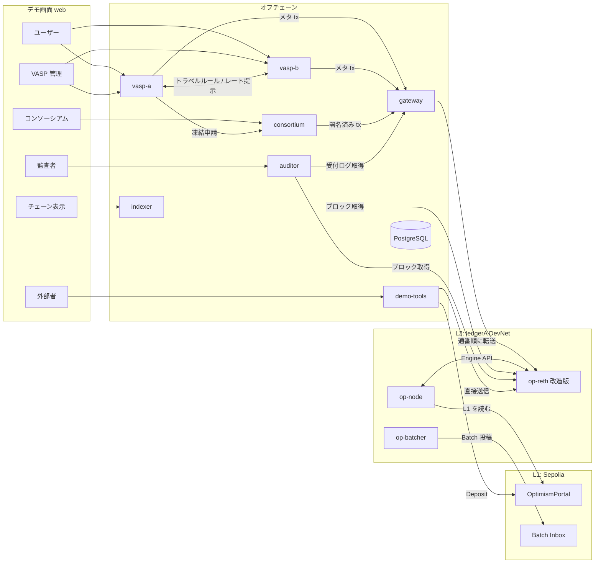

# 01 全体構成

## 1. 構成図



## 2. コンポーネント

### 2.1 チェーン層

| 名前 | 役割 | 実装 |
|---|---|---|
| op-reth | 実行クライアント。KYC 規則とプール検査を足した改造版 | fork からビルドした Docker イメージ |
| op-node | コンセンサスクライアント。Sequencer として動く | 公式イメージ |
| op-batcher | L2 の取引データを Sepolia に投稿する | 公式イメージ |
| op-conductor | Sequencer 3 台のリーダー選出（冗長化構成のみ） | 公式イメージ |

### 2.2 オフチェーン層

| 名前 | 運営者 | 役割 | ポート |
|---|---|---|---:|
| gateway | ネットワーク運営 | 取引の受付、通番と Receipt の発行、代理送信、通番順の転送、受付ログのコミット | 8600 |
| vasp-a | VASP A | 顧客管理、KYC、鍵の保管、送金、交換、トラベルルール、AML アラート | 8621 |
| vasp-b | VASP B | 同上。加えて交換レートの提示（マーケットメーカー役） | 8622 |
| consortium | コンソーシアム | 申請の受付、Safe の承認と実行 | 8630 |
| indexer | ネットワーク運営 | L2 のブロックを監査 DB に取り込む。検索 API を出す | 8640 |
| auditor | 監査者 | 受付ログと L2 ブロックを照合する。アドレス追跡の窓口 | 8650 |
| demo-tools | デモ運営 | 外部者の操作、順序入れ替えの仕掛け | 8660 |
| web | デモ運営 | 全役割の画面 | 3000 |
| postgres | - | 各サービスの DB。サービスごとにスキーマを分ける | 5432 |

- vasp-a と vasp-b は同じコードを別の設定で 2 つ起動する。
- サービス間で DB を直接読まない。必ず API を通す。

### 2.3 L2 コントラクト

| 名前 | 役割 | アドレス |
|---|---|---|
| `KycRegistry` | アドレスの所属、種別、状態。実行層が読む | `0x4200000000000000000000000000000000000700`（固定） |
| `LedgerToken` × 2 | tJPY、tUSD | デプロイ時に決まる |
| `TravelRuleCompliance` | トラベルルール承認の検証 | 同上 |
| `LedgerForwarder` | ERC-2771 のメタトランザクション転送 | 同上 |
| `AtomicSwap` | 署名付き Quote による 2 通貨の同時交換 | 同上 |
| `ReceiptLog` | 受付ログのハッシュ連鎖のコミット先 | 同上 |
| `ConsortiumSafe` | 2/3 のマルチシグ（Safe v1.3.0 のプロキシ） | 同上 |

デプロイ時に決まるアドレスは `deployments/<環境名>.json` に書き出す。サービスと画面はこのファイルを読む。

## 3. 検査の 4 層

登録状態の検査は 4 か所にある。正当性の根拠は「状態遷移」に置く。

| 層 | 場所 | 検査内容 | 位置づけ |
|---|---|---|---|
| 事前検査 | gateway | 送信者の登録状態、取引形式、nonce | 早期拒否。エラーをすぐ返す |
| プール | op-reth のプール検証 | 送信者の登録状態 | Gateway を通らない直接送信の早期拒否 |
| 状態遷移 | op-revm のハンドラ | 送信者の登録状態 | 根拠。全ノードが同じ判定をする。L1 Deposit にも効く |
| 資産移転 | `LedgerToken` | 送り手と受け手の保有資格、凍結、トラベルルール | トークン移転の地点での検査 |

上の 2 層は運営者が外せる。下の 2 層はブロックの再実行で検証される。

## 4. データの置き場所

| データ | 置き場所 | 見える人 |
|---|---|---|
| アドレス、所属 VASP ID、種別、状態、有効期限 | `KycRegistry`（オンチェーン） | 全員 |
| VASP の名前、API の URL、署名検証用アドレス | `KycRegistry`（オンチェーン） | 全員 |
| トークン残高、移転履歴 | `LedgerToken`（オンチェーン） | 全員 |
| トラベルルールの参照 ID（乱数 32 バイト） | 移転のイベント（オンチェーン） | 全員 |
| 氏名、生年月日、住所、メールアドレス | VASP の DB | その VASP だけ |
| トラベルルールの電文（送付人と受取人の情報） | 送付 VASP と受取 VASP の DB | 当事者の 2 社だけ |
| 顧客の秘密鍵（暗号化済み） | VASP の DB | その VASP だけ |
| 受付ログ（通番、取引ハッシュ、時刻、署名） | gateway の DB。API で公開 | 全員 |
| 受付ログのハッシュ連鎖の先頭 | `ReceiptLog`（オンチェーン） | 全員 |
| 取引と残高の検索用コピー | indexer の DB | 監査者、運営 |

オンチェーンに置く識別子は乱数とアドレスだけにする。氏名のハッシュは置かない。

## 5. アカウントと鍵

### 5.1 導出

- 運営側の鍵は 1 つのニーモニック `LEDGERA_MNEMONIC` から導出する。
- パスは `m/44'/60'/0'/0/{index}`。
- 顧客の鍵は VASP サービスが顧客ごとに乱数で生成する（5.3）。

### 5.2 運営側アカウント

| index | 名前 | 用途 | Sepolia で送信 | L2 で送信 | Registry の登録 |
|---:|---|---|:-:|:-:|---|
| 0 | admin | op-deployer の全ロール、L2 のデプロイ | ○ | ○ | OPERATOR / VASP 0 |
| 1 | batcher | Batch の投稿 | ○ | - | なし |
| 2 | sequencer | unsafe ブロックの署名 | - | - | なし |
| 3 | proposer | 未使用（op-deployer の入力に必要） | - | - | なし |
| 4 | challenger | 未使用（同上） | - | - | なし |
| 5 | gateway | Receipt の署名、`ReceiptLog` へのコミット | - | ○ | OPERATOR / VASP 0 |
| 6 | relayer-a | VASP A の代理送信 | - | ○ | RELAYER / VASP 1 |
| 7 | relayer-b | VASP B の代理送信 | - | ○ | RELAYER / VASP 2 |
| 8 | vasp-a-admin | VASP A の Registry 更新 | - | ○ | OPERATOR / VASP 1 |
| 9 | vasp-b-admin | VASP B の Registry 更新 | - | ○ | OPERATOR / VASP 2 |
| 10 | vasp-a-signer | VASP A のトラベルルール署名、VASP 間 API の署名 | - | - | VASP 1 の署名検証用アドレス |
| 11 | vasp-b-signer | VASP B の同上 | - | - | VASP 2 の署名検証用アドレス |
| 12 | vasp-b-treasury | VASP B の自己勘定。Quote に署名し、交換の相手方になる | - | - | VASP_TREASURY / VASP 2 |
| 13 | issuer | トークンの Mint、Burn、凍結 | - | ○ | OPERATOR / VASP 0 |
| 14 | consortium-1 | Safe の所有者 | - | ○ | OPERATOR / VASP 0 |
| 15 | consortium-2 | 同上 | - | ○ | OPERATOR / VASP 0 |
| 16 | consortium-3 | 同上 | - | ○ | OPERATOR / VASP 0 |
| 17 | attacker | デモの外部者。登録しない | ○ | 試みる | なし |

- VASP ID 0 はネットワーク運営を表す。VASP ID 1 が VASP A、2 が VASP B。
- vasp-b-treasury は取引を自分で送らない。必要な `approve` は代理送信で行う。

### 5.3 顧客アカウント

- VASP サービスが KYC 承認時に秘密鍵を生成する。
- 秘密鍵は AES-256-GCM で暗号化して VASP の DB に保存する。鍵は環境変数 `VASP_KEY_ENCRYPTION_KEY`。
- 顧客アドレスは ETH を持たない。L2 取引を直接送らず、メタトランザクションに署名するだけ。

### 5.4 必要な残高

| アカウント | チェーン | 量 | 入手方法 |
|---|---|---|---|
| admin | Sepolia | 3 ETH | faucet。必要量は M0 で実測する（要確認） |
| batcher | Sepolia | 0.5 ETH | admin から送る |
| attacker | Sepolia | 0.05 ETH | admin から送る |
| L2 で送信する運営側アカウント | L2 | 各 1 ETH | genesis で残高を持つ開発用アカウントから送る（02 章 5 節） |

## 6. 技術スタック

| 領域 | 採用 |
|---|---|
| ランタイム | Node.js 24（LTS） |
| パッケージ管理 | pnpm workspaces |
| 言語 | TypeScript（strict） |
| HTTP サーバー | Hono ＋ `@hono/node-server` |
| 入力検証 | zod |
| DB | PostgreSQL 17 ＋ Drizzle ORM |
| チェーン接続 | viem（OP Stack 拡張 `viem/op-stack` を含む） |
| 画面 | Next.js（App Router）＋ React ＋ Tailwind CSS ＋ TanStack Query |
| コントラクト | Solidity 0.8.28、Foundry、OpenZeppelin Contracts v5 |
| テスト | Vitest（サービス、E2E）、forge test（コントラクト）、cargo test（チェーン改造） |
| 整形と lint | Biome（TypeScript）、forge fmt（Solidity） |
| 実行環境 | Docker Compose |

npm パッケージのバージョンは導入時の最新安定版を `package.json` で固定する。

## 7. リポジトリ構成

```
leder-a/
  README.md
  docs/                      設計書
  Makefile                   起動と構築の入口
  docker-compose.yml         オフチェーン層（postgres、各サービス、web）
  docker-compose.anvil.yml   anvil モードの L2 代替
  .env.example
  package.json
  pnpm-workspace.yaml
  tsconfig.base.json
  biome.json

  chain/
    versions.env             上流のバージョン、fork の参照コミット
    compose/
      docker-compose.chain.yml   op-reth、op-node、op-batcher
      docker-compose.replica.yml 検証ノード
      docker-compose.ha.yml      Sequencer 3 台構成
    scripts/
      derive-accounts.ts     ニーモニックからアドレス一覧を出す
      deploy-l1.sh           op-deployer の取得、init、intent の編集、apply
      gen-config.sh          genesis.json、rollup.json、jwt.txt の生成。L1 アドレスの書き出し
      build-op-reth.sh       fork を取得して Docker イメージを作る
      bootstrap-l2.sh        Bootstrap.s.sol の実行、デプロイ結果の書き出し、拒否の確認
      compare-heads.sh       Sequencer と検証ノードのブロックハッシュを比べる
    .deployer/               op-deployer の状態（git 管理外）
    runtime/                 生成した設定とデータ（git 管理外）

  contracts/                 Foundry プロジェクト
    foundry.toml
    src/
      KycRegistry.sol
      LedgerToken.sol
      TravelRuleCompliance.sol
      LedgerForwarder.sol
      AtomicSwap.sol
      ReceiptLog.sol
      interfaces/
      libraries/
    script/
      Bootstrap.s.sol        L2 への初期デプロイと初期登録
    test/

  deployments/
    devnet.json              デプロイ結果（git 管理外）
    anvil.json               同上

  packages/
    config/                  環境変数のスキーマ、チェーン定義、デプロイ結果の読み込み
    abis/                    forge の出力から生成した ABI（`as const`）
    shared/                  EIP-712 の型定義、Receipt のハッシュ計算、エラー型、ロガー、HTTP 署名

  services/
    gateway/
    vasp/
    consortium/
    indexer/
    auditor/
    demo-tools/

  apps/
    web/

  e2e/                       デモ場面の自動テスト
```

各サービスのディレクトリ構成は共通にする。

```
services/<name>/
  package.json
  Dockerfile
  drizzle.config.ts
  src/
    index.ts        起動
    env.ts          環境変数の読み込みと検証
    routes/         HTTP ルート
    domain/         業務ロジック（HTTP と DB から独立）
    db/
      schema.ts     Drizzle のスキーマ
      migrations/
    chain/          viem クライアント、コントラクト呼び出し
  test/
```

## 8. 共通の実装規約

- 金額は最小単位の整数で扱う。JSON では 10 進文字列にする。
- アドレスは EIP-55 のチェックサム形式で返す。DB には 20 バイトの `bytea` で保存する。
- ハッシュと署名は `0x` 付き 16 進文字列で返す。DB には `bytea` で保存する。
- 時刻は API では ISO 8601（UTC）。Receipt の受付時刻だけはミリ秒の整数。
- エラー応答は `{ "error": { "code": "<識別子>", "message": "<説明>", "details": {} } }`。
- すべてのサービスは `GET /healthz` を持つ。
- RPC の URL を受ける環境変数（`L2_RPC_URL`、`AUDIT_RPC_URL`、`ROLLUP_RPC_URL`）は、カンマ区切りで複数指定できる。`packages/config` が viem の `fallback` で束ねる。冗長化構成では 3 台分を指定する。
- ログは JSON 1 行。`service`、`level`、`msg`、`traceId` を含める。
- サービス間の呼び出しには `X-Trace-Id` を引き継ぐ。
