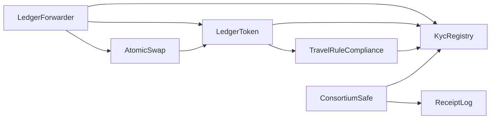
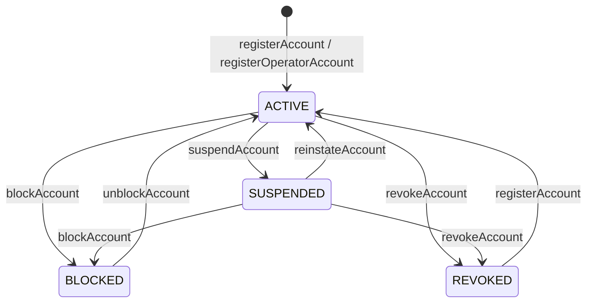

# 03 コントラクト

## 1. 一覧

| コントラクト | 継承・依存 | 所有者（初期化後） |
|---|---|---|
| `KycRegistry` | なし。OP Stack の `Proxy` の実装として置く | `ConsortiumSafe` |
| `LedgerToken`（tJPY、tUSD） | OZ `ERC20`、`ERC2771Context`、`Ownable` | issuer |
| `TravelRuleCompliance` | OZ `EIP712`、`Ownable` | issuer |
| `LedgerForwarder` | OZ `ERC2771Forwarder`。`KycRegistry` を参照する | なし |
| `AtomicSwap` | OZ `EIP712`、`ERC2771Context`、`Ownable` | admin |
| `ReceiptLog` | OZ `EIP712`、`Ownable` | `ConsortiumSafe` |
| `DepositProbe` | なし | なし |
| `ConsortiumSafe` | Safe v1.3.0（`SafeL2`）のプロキシ | 自身（所有者 3、しきい値 2） |

- Solidity 0.8.28。EVM バージョンは cancun。
- OZ は OpenZeppelin Contracts v5.1 以降。
- カスタムエラーを使う。`require` の文字列は使わない。
- EIP-712 の domain はどのコントラクトも `name`、`version`、`chainId`（L2 の chain ID）、`verifyingContract`（そのコントラクト自身）の 4 項目。各節の表には `name` と `version` だけを書く。
- `ERC2771Context` と `Ownable` を両方継承するコントラクトは、`_msgSender`、`_msgData`、`_contextSuffixLength` を `ERC2771Context` 側に解決する。

依存関係。



## 2. KycRegistry

### 2.1 役割

- アドレスごとに、所属 VASP、種別、状態、有効期限を持つ。
- VASP ごとに、状態、管理者、署名検証用アドレス、名前、API の URL を持つ。
- 実行層（02 章 6 節）とトークンの両方が参照する。

### 2.2 型

```solidity
enum AccountStatus { NONE, ACTIVE, SUSPENDED, BLOCKED, REVOKED }   // 0..4
enum AccountKind   { NONE, CUSTOMER, VASP_TREASURY, RELAYER, OPERATOR } // 0..4
enum VaspStatus    { NONE, ACTIVE, SUSPENDED }                     // 0..2

struct AccountView {
    uint32 vaspId;
    AccountKind kind;
    AccountStatus status;
    uint64 validUntil;   // UNIX 秒。0 は無期限
    uint64 updatedAt;
}

struct VaspView {
    VaspStatus status;
    address admin;
    address travelRuleSigner;
    string name;
    string endpoint;     // VASP 間 API の基点 URL
    uint64 updatedAt;
}
```

| 種別 | 意味 | 発信資格 | 保有資格 |
|---|---|:-:|:-:|
| `CUSTOMER` | VASP の顧客 | ○ | ○ |
| `VASP_TREASURY` | VASP の自己勘定 | ○ | ○ |
| `RELAYER` | 代理送信用アカウント | ○ | - |
| `OPERATOR` | 運営、VASP 管理者、発行体、コンソーシアム構成員 | ○ | - |

発信資格は「状態が `ACTIVE`、期限内、所属 VASP が `ACTIVE`」で決まる。種別は検査しない。

### 2.3 ストレージ配置

ERC-7201 の名前空間 `ledgera.storage.KycRegistry` を使う。基準スロット `B` は次の値。

```
B = keccak256(abi.encode(uint256(keccak256("ledgera.storage.KycRegistry")) - 1)) & ~bytes32(uint256(0xff))
  = 0x8fe41602647df745ca7420aedc6edbf55eb356a7ee29e0fe07118b9b158f2e00
```

```solidity
/// @custom:storage-location erc7201:ledgera.storage.KycRegistry
struct Layout {
    mapping(address => uint256) accounts;        // B + 0  実行層が読む
    mapping(uint32 => uint256) vasps;            // B + 1  実行層が読む
    uint256 flags;                               // B + 2  実行層が読む。bit 0 = 規則の有効フラグ
    uint64 version;                              // B + 3
    address consortium;                          // B + 3
    bool initialized;                            // B + 3
    mapping(uint32 => address) travelRuleSigner; // B + 4
    mapping(uint32 => string) vaspName;          // B + 5
    mapping(uint32 => string) vaspEndpoint;      // B + 6
    mapping(address => uint32) adminVaspIdPlus1; // B + 7  管理者 → VASP ID + 1
}
```

- 先頭 3 フィールドの順序と型は変えない。実行層が同じ位置を読む。
- `accounts` と `vasps` の値はコンパイラの構造体のパッキングに頼らず、`uint256` に手で詰める。
- VASP ID の最大値（`2^32 - 1`）の管理者は `vasps[id]` の管理者アドレスから逆引きする。

`accounts[a]` のワード。

| ビット | 幅 | フィールド |
|---|---:|---|
| 0〜7 | 8 | `status` |
| 8〜15 | 8 | `kind` |
| 16〜47 | 32 | `vaspId` |
| 48〜111 | 64 | `validUntil` |
| 112〜175 | 64 | `updatedAt` |
| 176〜255 | 80 | 予約（0） |

`vasps[id]` のワード。

| ビット | 幅 | フィールド |
|---|---:|---|
| 0〜7 | 8 | `status` |
| 8〜167 | 160 | `admin` |
| 168〜231 | 64 | `updatedAt` |
| 232〜255 | 24 | 予約（0） |

フィールドをワードに詰める処理と取り出す処理は `libraries/RegistryLayout.sol` にまとめる。

### 2.4 インターフェース

```solidity
interface IKycRegistry {
    // 初期化（ProxyAdmin.upgradeAndCall から 1 回だけ）
    function initialize(address consortium) external;

    // コンソーシアムだけ
    function registerVasp(
        uint32 vaspId, address admin, address travelRuleSigner,
        string calldata name, string calldata endpoint
    ) external;
    function setVaspStatus(uint32 vaspId, VaspStatus status) external;
    function setVaspKeys(uint32 vaspId, address admin, address travelRuleSigner) external;
    function registerOperatorAccount(address account, uint32 vaspId, AccountKind kind) external;
    function blockAccount(address account, bytes32 reason) external;
    function unblockAccount(address account) external;
    function enableEnforcement() external;
    function transferConsortium(address newConsortium) external;

    // VASP 管理者だけ（自社のアカウントに限る）
    function registerAccount(address account, AccountKind kind, uint64 validUntil) external;
    function suspendAccount(address account, bytes32 reason) external;
    function reinstateAccount(address account) external;
    function revokeAccount(address account) external;
    function renewAccount(address account, uint64 validUntil) external;
    function setVaspEndpoint(string calldata endpoint) external;

    // 参照
    function isActive(address account) external view returns (bool);
    function isHolder(address account) external view returns (bool);
    function isVerified(address account) external view returns (bool); // isHolder と同じ。ERC-3643 の IIdentityRegistry 互換
    function getAccount(address account) external view returns (AccountView memory);
    function vaspOf(address account) external view returns (uint32);
    function kindOf(address account) external view returns (AccountKind);
    function getVasp(uint32 vaspId) external view returns (VaspView memory);
    function travelRuleSignerOf(uint32 vaspId) external view returns (address);
    function vaspIdOfAdmin(address admin) external view returns (bool found, uint32 vaspId);
    function enforcementEnabled() external view returns (bool);
    function version() external view returns (uint64);
    function consortium() external view returns (address);
}
```

### 2.5 動作

判定。

- `isActive(a)`: `status == ACTIVE`、かつ `validUntil == 0 || block.timestamp <= validUntil`、かつ `vasps[vaspId].status == ACTIVE`。実行層の判定（02 章 6.1 の手順 4〜6）と同じ結果になる。
- `isHolder(a)`: `isActive(a)`、かつ `kind` が `CUSTOMER` か `VASP_TREASURY`。
- `enforcementEnabled` は `isActive` に影響しない。トークンの検査は常に有効。

権限と前提。

| 関数 | 呼べる者 | 前提 | 結果 |
|---|---|---|---|
| `registerVasp` | コンソーシアム | `vaspId` が未登録 | VASP を `ACTIVE` で登録。`admin` を `OPERATOR` / `ACTIVE` で登録 |
| `setVaspStatus` | コンソーシアム | VASP が登録済み。`vaspId != 0` | 状態を変更 |
| `setVaspKeys` | コンソーシアム | VASP が登録済み | 管理者と署名検証用アドレスを差し替える。新しい管理者を `OPERATOR` で登録し、旧管理者が `ACTIVE` または `SUSPENDED` なら `REVOKED` にする |
| `registerOperatorAccount` | コンソーシアム | `kind` が `RELAYER` か `OPERATOR`。アカウントが `NONE` | `ACTIVE`、無期限で登録 |
| `blockAccount` | コンソーシアム | 状態が `ACTIVE` か `SUSPENDED` | `BLOCKED` にする |
| `unblockAccount` | コンソーシアム | 状態が `BLOCKED` | `ACTIVE` にする |
| `enableEnforcement` | コンソーシアム | フラグが 0 | フラグを 1 にする。戻せない |
| `transferConsortium` | コンソーシアム | 新しいアドレスが 0 でない | コンソーシアムのアドレスを差し替える |
| `setVaspEndpoint` | VASP 管理者 | VASP が `ACTIVE` | 自社の `endpoint` を更新する |
| `registerAccount` | VASP 管理者 | VASP が `ACTIVE`。`kind` が `CUSTOMER` か `VASP_TREASURY`。アカウントが `NONE` か `REVOKED` | 自社の所属で `ACTIVE` にする |
| `suspendAccount` | VASP 管理者 | 自社のアカウント。状態が `ACTIVE` | `SUSPENDED` にする |
| `reinstateAccount` | VASP 管理者 | 自社のアカウント。状態が `SUSPENDED` | `ACTIVE` にする |
| `revokeAccount` | VASP 管理者 | 自社のアカウント。状態が `ACTIVE` か `SUSPENDED` | `REVOKED` にする |
| `renewAccount` | VASP 管理者 | 自社のアカウント。状態が `ACTIVE` | `validUntil` を更新 |

- VASP 管理者は呼び出し時に `ACTIVE` である必要がある。操作対象は自社の `CUSTOMER` と `VASP_TREASURY` に限る。
- VASP 管理者は `BLOCKED` のアカウントを変更できない。
- Registry の初期化はプロキシ経由で行う。
- 初期化時の `version` は 1。状態が変わる操作のたびに 1 増やす。
- 管理者を登録または差し替えるとき、他社の管理者と、他社の失効前のアカウントは指定できない。
- `reason` は申請 ID などの乱数 32 バイト。個人情報やそのハッシュを入れない。
- `REVOKED` のアドレスは別の VASP が登録し直せる。所属変更はこの手順で行う。

状態遷移。



### 2.6 イベントとエラー

```solidity
event VaspRegistered(uint32 indexed vaspId, address admin, address travelRuleSigner, string name, string endpoint, uint64 version);
event VaspStatusChanged(uint32 indexed vaspId, VaspStatus status, uint64 version, address indexed actor);
event VaspKeysChanged(uint32 indexed vaspId, address admin, address travelRuleSigner, uint64 version);
event VaspEndpointChanged(uint32 indexed vaspId, string endpoint);
event AccountUpdated(
    address indexed account, uint32 indexed vaspId, AccountKind kind, AccountStatus status,
    uint64 validUntil, uint64 version, address indexed actor, bytes32 reason
);
event EnforcementEnabled(uint64 version, address indexed actor);
event ConsortiumTransferred(address indexed previous, address indexed current);

error AlreadyInitialized();
error EnforcementAlreadyEnabled();
error NotConsortium(address caller);
error NotVaspAdmin(address caller);
error VaspAlreadyRegistered(uint32 vaspId);
error VaspNotFound(uint32 vaspId);
error VaspNotActive(uint32 vaspId);
error SystemVaspCannotBeSuspended();
error InvalidVaspStatus(VaspStatus status);
error InvalidKind(AccountKind kind);
error InvalidTransition(address account, AccountStatus from, AccountStatus to);
error AccountOfOtherVasp(address account, uint32 vaspId);
error ZeroAddress();
```

`AccountUpdated` はアカウントの変更すべてで出す。Indexer はこのイベントだけで履歴を作る。

### 2.7 テスト

- ストレージ: `vm.load` で読んだ 02 章 6.2 のテストベクタのスロットの値が、詰めた値と一致する。
- 権限: 表のとおりに許可と拒否が出る。
- 状態遷移: 図にない遷移が `InvalidTransition` になる。
- `isActive`: 期限切れ、VASP 停止で false になる。
- `enableEnforcement`: 2 回目が revert する。

## 3. LedgerToken

### 3.1 役割

- ステーブルコイン。tJPY と tUSD を別々にデプロイする。小数 6 桁。
- ERC-20 に、ERC-3643 のトークン側の機能（凍結、強制移転、一時停止、発行と償却）を追加する。
- 移転のたびに Registry とトラベルルールを検査する。

### 3.2 インターフェース

ERC-20 の標準関数に加えて、次を持つ。

```solidity
interface ILedgerToken /* is IERC20, IERC20Metadata */ {
    // 利用者（メタトランザクション経由）
    function transferWithTravelRule(
        address to, uint256 amount,
        TravelRuleAttestation calldata attestation, bytes calldata signature
    ) external returns (bool);

    // agent だけ（ERC-3643）
    function mint(address to, uint256 amount) external;
    function burn(address account, uint256 amount) external;
    function forcedTransfer(address from, address to, uint256 amount) external returns (bool);
    function setAddressFrozen(address account, bool freeze) external;
    function freezePartialTokens(address account, uint256 amount) external;
    function unfreezePartialTokens(address account, uint256 amount) external;
    function pause() external;
    function unpause() external;

    // 所有者だけ
    function addAgent(address agent) external;
    function removeAgent(address agent) external;

    // 参照（ERC-3643）
    function isAgent(address account) external view returns (bool);
    function isFrozen(address account) external view returns (bool);
    function getFrozenTokens(address account) external view returns (uint256);
    function paused() external view returns (bool);
    function identityRegistry() external view returns (address); // KycRegistry
    function compliance() external view returns (address);       // TravelRuleCompliance
    function onchainID() external view returns (address);        // address(0)
    function version() external pure returns (string memory);
}
```

コンストラクタ。

```solidity
constructor(
    string memory name_, string memory symbol_,
    address registry_, address compliance_, address trustedForwarder_, address owner_
)
```

ERC-3643 のうち実装しない関数: 一括操作（`batch*`）、`recoveryAddress`、`setName`、`setSymbol`、`setOnchainID`、`setIdentityRegistry`、`setCompliance`。Registry と Compliance の参照先は変更できない。

### 3.3 移転時の検査

OZ v5 の `_update(from, to, value)` を上書きする。

| 場合 | 検査 |
|---|---|
| 発行（`from == 0`） | `isHolder(to)`。`to` が凍結されていない |
| 償却（`to == 0`） | 検査なし。凍結していない残高が足りなければ、不足分の部分凍結を解く |
| 強制移転 | `isHolder(to)`。凍結していない残高が足りなければ、不足分の部分凍結を解く。ほかの検査は行わない |
| 通常の移転 | 下の 1〜5 を順に行う |

通常の移転の検査。

1. 一時停止中でない。→ `EnforcedPause()`
2. `from` と `to` が凍結されていない。→ `AccountFrozen(account)`
3. `balanceOf(from) - getFrozenTokens(from) >= value`。→ `InsufficientUnfrozenBalance(from, available, value)`
4. `isHolder(from)` かつ `isHolder(to)`。→ `AccountNotEligible(account)`
5. `compliance.requiresTravelRule(from, to)` が true なら、承認が消費済みである。→ `TravelRuleRequired(from, to)`

- `transferFrom` も同じ検査を受ける。呼び出し元（spender）の登録状態は検査しない。
- 「強制移転中」と「承認が消費済み」は transient storage のフラグで `_update` に伝える。
- `approve` は `_update` を通らない。トークンは `approve` の呼び出し元を検査しない。停止や遮断されたアドレスの `approve` は、代理送信なら `LedgerForwarder`（5.3）、直接送信なら実行層（02 章 6 節）が止める。

`transferWithTravelRule` の処理。

1. `from = _msgSender()`。
2. `compliance.consume(attestation, signature, from, to, amount)` を呼ぶ。検証に失敗すると revert する。
3. 承認消費済みフラグを立てる。
4. `_transfer(from, to, amount)`。
5. フラグを下ろす。
6. `TravelRuleTransfer(attestation.refId, from, to, amount)` を出す。

### 3.4 イベントとエラー

```solidity
event TravelRuleTransfer(bytes32 indexed refId, address indexed from, address indexed to, uint256 amount);
event AddressFrozen(address indexed account, bool indexed isFrozen, address indexed agent);
event TokensFrozen(address indexed account, uint256 amount);
event TokensUnfrozen(address indexed account, uint256 amount);
event Paused(address agent);
event Unpaused(address agent);
event AgentAdded(address indexed agent);
event AgentRemoved(address indexed agent);

error NotAgent(address caller);
error EnforcedPause();
error AccountFrozen(address account);
error InsufficientUnfrozenBalance(address account, uint256 available, uint256 needed);
error AccountNotEligible(address account);
error TravelRuleRequired(address from, address to);
```

イベント `AddressFrozen` は ERC-3643 の名前。エラーは同名を避けて `AccountFrozen` にしている。

### 3.5 テスト

- 未登録の受け手への移転が `AccountNotEligible` になる。
- `SUSPENDED`、`BLOCKED`、期限切れ、VASP 停止の各状態で移転が止まる。
- 別 VASP の顧客への `transfer` が `TravelRuleRequired` になる。
- 正しい承認付きの `transferWithTravelRule` が成功する。同じ承認の再利用が失敗する。
- 顧客と自己勘定の間の移転は承認なしで成功する。
- 凍結、部分凍結、一時停止、強制移転、発行、償却。
- `LedgerForwarder` 経由の呼び出しで `_msgSender()` が署名者になる。

## 4. TravelRuleCompliance

### 4.1 役割

- 移転にトラベルルールの承認が要るかを判定する。
- 受取 VASP が署名した承認を検証し、使用済みにする。

### 4.2 承認の形式

```solidity
struct TravelRuleAttestation {
    bytes32 refId;             // 乱数 32 バイト。電文の参照 ID
    address originator;        // 送り手のアドレス
    address beneficiary;       // 受け手のアドレス
    address token;
    uint256 amount;
    uint32 originatorVaspId;
    uint32 beneficiaryVaspId;
    uint64 expiry;             // UNIX 秒
}
```

EIP-712。

| 項目 | 値 |
|---|---|
| domain `name` | `ledgerA TravelRule` |
| domain `version` | `1` |
| 型 | `TravelRuleAttestation(bytes32 refId,address originator,address beneficiary,address token,uint256 amount,uint32 originatorVaspId,uint32 beneficiaryVaspId,uint64 expiry)` |
| 署名者 | `registry.travelRuleSignerOf(beneficiaryVaspId)` |

承認に個人情報は入れない。電文のハッシュも入れない。`refId` と電文の対応は当事者 VASP の DB にだけある。

### 4.3 インターフェース

```solidity
interface ITravelRuleCompliance {
    function requiresTravelRule(address from, address to) external view returns (bool);
    function canTransfer(address from, address to, uint256 amount) external view returns (bool); // !requiresTravelRule。ERC-3643 の ICompliance 互換
    function consume(
        TravelRuleAttestation calldata attestation, bytes calldata signature,
        address from, address to, uint256 amount
    ) external;                                   // 登録済みトークンだけ
    function isUsed(bytes32 refId) external view returns (bool);
    function hashAttestation(TravelRuleAttestation calldata attestation) external view returns (bytes32); // EIP-712 digest
    function bindToken(address token) external;   // 所有者だけ
    function isBoundToken(address token) external view returns (bool);
}
```

コンストラクタ。

```solidity
constructor(address registry_, address owner_) EIP712("ledgerA TravelRule", "1")
```

`requiresTravelRule(from, to)` は次をすべて満たすとき true。

- `kindOf(from) == CUSTOMER`
- `kindOf(to) == CUSTOMER`
- `vaspOf(from) != vaspOf(to)`

顧客と自己勘定の間の移転（交換で行う両方の移転を含む）は対象外。VASP 自身が相手方のため。

`consume` の検査。1 つでも外れると revert する。

| 検査 | エラー |
|---|---|
| 呼び出し元が登録済みトークン | `NotBoundToken(caller)` |
| `attestation.token == msg.sender` | `AttestationMismatch()` |
| `attestation.originator == from`、`attestation.beneficiary == to`、`attestation.amount == amount` | `AttestationMismatch()` |
| `attestation.originatorVaspId == vaspOf(from)`、`attestation.beneficiaryVaspId == vaspOf(to)` | `AttestationMismatch()` |
| `block.timestamp <= attestation.expiry` | `AttestationExpired(expiry)` |
| `attestation.refId` が未使用 | `AttestationAlreadyUsed(refId)` |
| 署名から復元したアドレスが受取 VASP の署名検証用アドレス | `InvalidAttestationSigner(recovered, expected)` |

通過したら `refId` を使用済みにして、イベントを出す。

```solidity
event TravelRuleAttestationConsumed(
    bytes32 indexed refId, uint32 indexed originatorVaspId, uint32 indexed beneficiaryVaspId,
    address token, address originator, address beneficiary, uint256 amount
);
```

### 4.4 テスト

- 各フィールドを 1 つずつ変えた承認が `AttestationMismatch` になる。
- 期限切れ、再利用、別 VASP の鍵での署名が拒否される。
- トークン以外からの `consume` が拒否される。
- TypeScript（`packages/shared`）で作った署名を Solidity が受け入れる。

## 5. LedgerForwarder

### 5.1 役割

利用者が署名したメタトランザクションを、代理送信用アカウントが実行するための転送コントラクト。OZ の `ERC2771Forwarder` を継承する。

- 代理送信では、L2 取引の送信者は代理送信用アカウントになる。実行層の規則（02 章 6 節）が検査するのはこの送信者で、署名者ではない。
- 署名者の発信資格は、このコントラクトが実行のたびに検査する。

```solidity
contract LedgerForwarder is ERC2771Forwarder {
    error SignerNotAllowed(address signer);

    constructor(address registry_) ERC2771Forwarder("ledgerA Forwarder") {}

    function registry() external view returns (address); // KycRegistry

    /// 失敗時に、呼び出し先の revert データをそのまま返す
    function execute(ForwardRequestData calldata request) public payable override;

    /// 全件が成功しなければ全体を revert する
    function executeAll(ForwardRequestData[] calldata requests) external payable;

    /// 署名者が Registry で有効でなければ revert する
    function _execute(ForwardRequestData calldata request, bool requireValidRequest)
        internal override returns (bool);
}
```

### 5.2 リクエストの形式

OZ v5 の定義をそのまま使う。

```solidity
struct ForwardRequestData {
    address from;      // 署名者（利用者のアドレス）
    address to;        // 呼び出し先
    uint256 value;     // 常に 0
    uint256 gas;       // 呼び出し先に渡すガス
    uint48 deadline;   // UNIX 秒
    bytes data;        // 呼び出しデータ
    bytes signature;
}
```

| 項目 | 値 |
|---|---|
| domain `name` | `ledgerA Forwarder` |
| domain `version` | `1` |
| 型 | `ForwardRequest(address from,address to,uint256 value,uint256 gas,uint256 nonce,uint48 deadline,bytes data)` |
| nonce | `forwarder.nonces(from)`。署名者ごとの連番 |

呼び出し先は `isTrustedForwarder(forwarder)` が true を返すコントラクトだけ。`LedgerToken` × 2 と `AtomicSwap` が該当する。

### 5.3 上書きする動作

- `_execute`: 先頭で `registry.isActive(request.from)` を確かめる。false なら `SignerNotAllowed(request.from)` で revert する。その後に OZ の `_execute` を呼ぶ。
  - `execute`、`executeAll`、OZ の `executeBatch` は、どれも `_execute` を通る。
  - 判定は実行層の発信資格と同じ。状態が `ACTIVE`、期限内、所属 VASP が `ACTIVE`（2.5）。
  - 呼び出し先と関数を問わない。`approve` のように移転を伴わない呼び出しも、署名者が停止、遮断、期限切れなら実行されない。
  - `request.from` が署名者と一致することは、続く OZ の検証が確かめる。一致しなければ `ERC2771ForwarderInvalidSigner` で revert する。
  - revert するので、署名者の nonce は消費されない。
- `execute`: OZ の実装は、呼び出し先が失敗すると理由を捨てて `FailedCall()` で revert する。上書きして、呼び出し先の revert データをそのまま返す。失敗理由（`AccountNotEligible` など）を、`eth_call`、`eth_estimateGas`、トレースの最上位で取れるようにするため。
  - `_execute(request, true)` が false を返した直後に、`returndatacopy` で直前の呼び出しの戻りデータを取り出して revert する。
- `executeAll`: 各リクエストを `_execute(request, true)` で順に実行する。1 件でも失敗したら、その revert データで全体を revert する。OZ の `executeBatch` は呼び出し先の失敗で全体を止めないので使わない。

nonce は連番なので、同じ署名者のリクエストは署名した順にしか実行できない。VASP サービスは顧客ごとに 1 件ずつ処理する（05 章）。

### 5.4 テスト

- 署名者が `_msgSender()` として呼び出し先に伝わる。
- 署名の改ざん、期限切れ、nonce の不一致が拒否される。
- 呼び出し先のカスタムエラーが `execute` の revert データとして返る。
- `executeAll` で 2 件目が失敗すると、1 件目の効果も残らない。
- 署名者が未登録、`SUSPENDED`、`BLOCKED`、期限切れ、VASP 停止のとき、`execute` と `executeAll` が `SignerNotAllowed` で revert する。署名者の nonce は変わらない。
- 遮断された署名者の `approve` が実行されず、allowance が変わらない。
- 遮断を解くと、同じ署名のリクエストが実行できる。

## 6. AtomicSwap

### 6.1 役割

マーケットメーカーが署名した Quote を、利用者が実行する。2 通貨の移転を 1 取引で行う。片方が失敗すれば全体が revert する。

### 6.2 Quote の形式

```solidity
struct Quote {
    address maker;        // レートを出す側。署名者
    address taker;        // 実行する側
    address makerToken;   // maker が渡すトークン
    address takerToken;   // taker が渡すトークン
    uint256 makerAmount;
    uint256 takerAmount;
    uint64 expiry;        // UNIX 秒
    uint256 nonce;        // maker ごとに一意
}
```

| 項目 | 値 |
|---|---|
| domain `name` | `ledgerA AtomicSwap` |
| domain `version` | `1` |
| 型 | `Quote(address maker,address taker,address makerToken,address takerToken,uint256 makerAmount,uint256 takerAmount,uint64 expiry,uint256 nonce)` |
| 署名者 | `maker` |

### 6.3 インターフェース

```solidity
interface IAtomicSwap {
    function fill(Quote calldata quote, bytes calldata makerSignature) external;
    function cancel(uint256 nonce) external;                       // maker だけ
    function isNonceUsed(address maker, uint256 nonce) external view returns (bool);
    function hashQuote(Quote calldata quote) external view returns (bytes32); // EIP-712 digest
    function setSupportedToken(address token, bool supported) external;       // 所有者だけ
    function isSupportedToken(address token) external view returns (bool);

    event Filled(
        bytes32 indexed quoteHash, address indexed maker, address indexed taker,
        address makerToken, uint256 makerAmount, address takerToken, uint256 takerAmount
    );
    event Cancelled(address indexed maker, uint256 nonce);

    error NotTaker(address caller);
    error QuoteExpired(uint64 expiry);
    error QuoteNonceUsed(address maker, uint256 nonce);
    error InvalidMakerSignature();
    error UnsupportedToken(address token);
}
```

コンストラクタ。

```solidity
constructor(address trustedForwarder_, address owner_) EIP712("ledgerA AtomicSwap", "1")
```

`fill` の処理。

1. `_msgSender() == quote.taker`。
2. 両トークンが対応トークンで、互いに異なる。
3. `block.timestamp <= quote.expiry`。
4. `(maker, nonce)` が未使用。使用済みにする。
5. 署名から復元したアドレスが `quote.maker`。
6. `takerToken.transferFrom(taker, maker, takerAmount)`。
7. `makerToken.transferFrom(maker, taker, makerAmount)`。
8. `Filled` を出す。

- トークンは `AtomicSwap` を経由しない。当事者間で直接動く。
- 登録状態と凍結の検査は、それぞれの `transferFrom` の中でトークンが行う。
- 全量約定だけ。部分約定はない。

### 6.4 allowance

- maker（vasp-b-treasury）は初期化時に `AtomicSwap` へ上限つきの `approve` を済ませる（02 章 5 節）。
- taker は交換のたびに、`approve(AtomicSwap, takerAmount)` と `fill` の 2 リクエストに署名する。Gateway が `LedgerForwarder.executeAll` で 1 取引にまとめる。

### 6.5 テスト

- 正常な約定で両者の残高が入れ替わる。
- 期限切れ、nonce の再利用、署名の改ざん、taker 以外の実行が拒否される。
- maker の残高不足で 2 つ目の移転が失敗すると、1 つ目の移転も巻き戻る。
- taker が `BLOCKED` のとき全体が revert する。
- `executeAll` 経由の `approve` ＋ `fill` が 1 取引で成功する。

## 7. ReceiptLog

### 7.1 役割

Gateway の受付ログ（ハッシュ連鎖）の最新のハッシュを、定期的に L2 に記録する。記録後は Gateway がログを書き換えられない。Receipt の署名検証に使うアドレスもここに置く。

### 7.2 Receipt の形式

Receipt は Gateway がオフチェーンで発行する。形式はこのコントラクトを基準に定義する。

```solidity
struct Receipt {
    uint64 seq;           // 通番。1 から
    bytes32 txHash;       // L2 取引のハッシュ
    address sender;       // L2 取引の送信者
    uint64 receivedAtMs;  // 受付時刻。UNIX ミリ秒
    bytes32 prevHash;     // 直前のエントリのハッシュ。seq 1 では genesisHash
}
```

| 項目 | 値 |
|---|---|
| domain `name` | `ledgerA Gateway` |
| domain `version` | `1` |
| 型 | `Receipt(uint64 seq,bytes32 txHash,address sender,uint64 receivedAtMs,bytes32 prevHash)` |
| エントリのハッシュ `entryHash` | EIP-712 の `hashStruct(receipt)` |
| 署名 | EIP-712 の digest に対する `gatewaySigner` の署名 |
| `genesisHash` | `keccak256(abi.encode("ledgerA ReceiptLog", block.chainid, address(this)))` |

連鎖: `prevHash(n) = entryHash(n - 1)`。

### 7.3 インターフェース

```solidity
interface IReceiptLog {
    function commit(uint64 fromSeq, uint64 toSeq, bytes32 headHash) external; // gateway だけ
    function setGateway(address gateway, address signer) external;            // 所有者だけ

    function gateway() external view returns (address);        // commit を呼べるアカウント
    function gatewaySigner() external view returns (address);  // Receipt の署名者
    function genesisHash() external view returns (bytes32);
    function lastSeq() external view returns (uint64);
    function lastHash() external view returns (bytes32);
    function commitCount() external view returns (uint64);
    function hashReceipt(Receipt calldata receipt) external pure returns (bytes32);        // entryHash
    function verifyReceipt(Receipt calldata receipt, bytes calldata signature) external view returns (bool);

    event Committed(uint64 indexed commitIndex, uint64 fromSeq, uint64 toSeq, bytes32 headHash, uint64 timestamp);
    event GatewayChanged(address gateway, address signer);

    error NotGateway(address caller);
    error NonContiguousCommit(uint64 expectedFromSeq, uint64 fromSeq);
    error EmptyCommit();
}
```

コンストラクタ。

```solidity
constructor(address gateway_, address gatewaySigner_, address owner_) EIP712("ledgerA Gateway", "1")
```

`commit` の検査。

- 呼び出し元が `gateway`。
- `fromSeq == lastSeq + 1`。
- `toSeq >= fromSeq`。

DevNet では `gateway` と `gatewaySigner` は同じアドレス（01 章の index 5）。

### 7.4 テスト

- 連続しないコミットが拒否される。
- TypeScript で計算した `entryHash` と署名が、`hashReceipt` と `verifyReceipt` で一致する。

## 8. ConsortiumSafe

### 8.1 構成

- OP Stack の genesis に入っている Safe v1.3.0 を使う。`SafeL2` の実装は `0xfb1bffC9d739B8D520DaF37dF666da4C687191EA`。
- プロキシファクトリは genesis に入っていない。`safe-contracts` v1.3.0 を Foundry の依存に入れ、`GnosisSafeProxy` を直接デプロイする。
- デプロイ後に `setup` を呼ぶ。

  ```solidity
  setup(owners /* consortium-1..3 */, 2, address(0), "", address(0), address(0), 0, payable(address(0)));
  ```

### 8.2 操作の流れ

1. 実行したい呼び出し `(to, data)` と Safe の `nonce()` から、ハッシュを得る。

   ```solidity
   getTransactionHash(to, 0, data, 0 /* Call */, 0, 0, 0, address(0), address(0), nonce)
   ```

2. 構成員がそれぞれ `approveHash(hash)` を送る。イベント `ApproveHash(hash, owner)` が残る。
3. しきい値に達したら、構成員の 1 人が `execTransaction` を送る。

   ```solidity
   execTransaction(to, 0, data, 0, 0, 0, 0, address(0), payable(address(0)), signatures)
   ```

4. `signatures` は、承認した所有者をアドレスの昇順に並べ、所有者ごとに次の 65 バイトを連結して作る。

   ```
   r = 所有者アドレス（上位 12 バイトを 0 にした 32 バイト） / s = 0（32 バイト） / v = 1（1 バイト）
   ```

- 実行者自身は `approveHash` を省略できる。`v = 1` の署名は「実行者が本人」でも受け入れられる。
- `execTransaction` を送るのは所有者でなくてもよい。しきい値の数の `approveHash` が済んでいれば、L2 に取引を送れるアカウントなら誰でも実行できる。
- `safeTxGas` と `gasPrice` を 0 にしているので、内側の呼び出しが失敗すると `execTransaction` 全体が revert する。nonce は進まない。
- 成功すると `ExecutionSuccess(hash, 0)` が出る。nonce が 1 進む。

承認の失効と取消取引。

- `approveHash` で記録した承認（`approvedHashes`）を消す関数はない。そのハッシュの nonce が消費されるまで、承認済みの操作は L2 で実行できる。
- 承認済みの操作を失効させるには、同じ nonce の取消取引を実行する。取消取引は `to` が `ConsortiumSafe` 自身、`value` が 0、`data` が空。
- 取消取引も、ほかの操作と同じく 2 者の承認で実行する。成功すると nonce が 1 進み、元のハッシュは実行できなくなる。
- 申請の取り下げはこの手順で行う（06 章 4.4）。

Safe を通して行う操作。

| 対象 | 関数 |
|---|---|
| `KycRegistry` | `registerVasp`、`setVaspStatus`、`setVaspKeys`、`registerOperatorAccount`、`blockAccount`、`unblockAccount` |
| `ReceiptLog` | `setGateway` |
| L2 `ProxyAdmin` | `upgrade`（Registry の実装差し替え） |
| `ConsortiumSafe` 自身 | 取消取引（データなし） |

## 9. DepositProbe

### 9.1 役割

L1 Deposit に実行層の規則が適用されたかを確かめるための、呼び出し元ごとのカウンタ（02 章 9.1、10.2）。

- Registry を参照しない。所有者も権限もない。誰が呼んでも成功する。
- 標準の実行層では、未登録アドレスの Deposit でも `poke()` が成功する。改造版では実行されない。
- 結果の違いが実行層の規則だけで決まる。トークンのように、コントラクト側の検査で失敗することがない。

```solidity
contract DepositProbe {
    mapping(address => uint256) public count;

    event Poked(address indexed caller, uint256 count);

    function poke() external {
        uint256 next = ++count[msg.sender];
        emit Poked(msg.sender, next);
    }
}
```

### 9.2 テスト

- `poke()` のたびに、呼び出し元の `count` が 1 増える。ほかのアドレスの `count` は変わらない。

## 10. デプロイ結果の形式

`deployments/<環境名>.json`。

```json
{
  "environment": "devnet",
  "chainId": 202610,
  "enforcementBlock": 0,
  "auditStartBlock": 0,
  "l1": {
    "chainId": 11155111,
    "optimismPortal": "0x…",
    "systemConfig": "0x…"
  },
  "contracts": {
    "kycRegistry": "0x4200000000000000000000000000000000000700",
    "ledgerForwarder": "0x…",
    "travelRuleCompliance": "0x…",
    "tJPY": "0x…",
    "tUSD": "0x…",
    "atomicSwap": "0x…",
    "receiptLog": "0x…",
    "depositProbe": "0x…",
    "consortiumSafe": "0x…"
  },
  "vasps": { "network": 0, "a": 1, "b": 2 }
}
```

## 11. anvil モードでの違い

| 項目 | devnet | anvil |
|---|---|---|
| `KycRegistry` のアドレス | `0x42…0700`（OP Stack の `Proxy`） | 通常のアドレス（OZ の `ERC1967Proxy`） |
| Safe の実装 | genesis のもの | `Bootstrap.s.sol` がデプロイする |
| 規則の有効化 | 実行層が強制する | フラグは立つが、実行層は強制しない |
| `LedgerForwarder` の署名者の検査 | 働く | 働く |
| `DepositProbe` | 場面 4 の Deposit の宛先 | デプロイするが使わない。L1 Deposit がない |
| `l1` | Sepolia のアドレス | 省略 |

コントラクトは Registry のアドレスをコンストラクタで受け取る。ハードコードしない。
