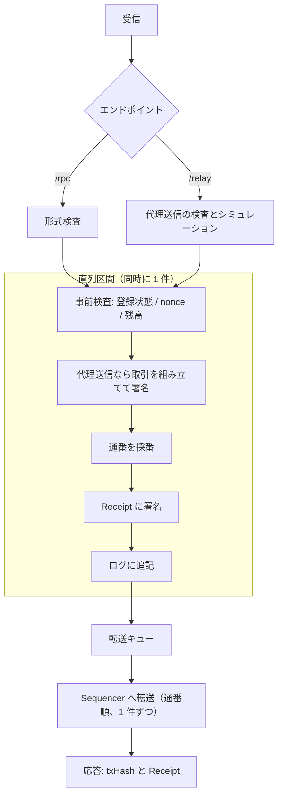

# 04 受付 Gateway

## 1. 役割

L2 取引を受け付けるのは Gateway だけ。Gateway は次の 5 つを行う。

| 機能 | 内容 | 要件 |
|---|---|---|
| 受付 | 取引を検査し、到着順に通番を振る | 16 |
| Receipt | 通番、取引ハッシュ、受付時刻に署名して返す。ハッシュ連鎖でログに追記する | 17 |
| 代理送信 | 利用者が署名したメタトランザクションを、運営側のアカウントで L2 取引にする | 22 |
| 転送 | 通番順に 1 件ずつ Sequencer へ送る。Sequencer の切替時は再送する | 16, 19 |
| コミット | ハッシュ連鎖の最新のハッシュを定期的に `ReceiptLog` に記録する | 17 |

- 1 プロセスだけ起動する。複数起動すると通番が分岐する。
- 運営者はネットワーク運営。

## 2. 取引を受け付けるエンドポイント

| エンドポイント | 利用者 | 入力 |
|---|---|---|
| `POST /rpc`（JSON-RPC） | VASP 管理者、コンソーシアム構成員、発行体、Gateway 自身 | 署名済みの L2 取引 |
| `POST /relay/v1/forward` | VASP サービス | 利用者が署名した `ForwardRequestData` |

どちらも同じ直列区間に入り、同じ系列の通番を受け取る。

## 3. 処理の流れ



- 直列区間は非同期ミューテックスで守る。採番と DB への追記は 1 つの DB トランザクションで行う。
- 受付時刻は直列区間に入った時点の時計の値。時計が戻った場合は前の受付時刻を使う。
- 応答は転送の結果を最大 15 秒待つ。転送済みなら正常応答を返す。拒否または待ち時間超過の場合、エラーに発行済みの Receipt を入れる。待ち時間を超えた取引は引き続き転送する。

## 4. 受付の規則

### 4.1 形式検査

| 検査 | 拒否コード |
|---|---|
| RLP と署名が正しい | `INVALID_TX` |
| 種別が EIP-1559（0x02） | `UNSUPPORTED_TX_TYPE` |
| chain ID が L2 のもの | `WRONG_CHAIN_ID` |
| `maxPriorityFeePerGas == FIXED_PRIORITY_FEE_WEI`（1 wei） | `PRIORITY_FEE_NOT_FIXED` |
| `maxFeePerGas >= 現在の base fee × 2 + 1` | `MAX_FEE_TOO_LOW` |
| `gas <= GAS_LIMIT_CAP` | `GAS_LIMIT_TOO_HIGH` |
| 同じ取引ハッシュが未受付 | `DUPLICATE_TX` |

最大手数料と重複は直列区間で確認する。最大手数料には最新の base fee を使う。

### 4.2 事前検査（直列区間の中）

| 検査 | 拒否コード |
|---|---|
| 送信者が `KycRegistry.isActive` | `SENDER_NOT_ALLOWED` |
| nonce が期待値と一致 | `NONCE_TOO_LOW`、`NONCE_GAP` |
| 残高が `gas × maxFeePerGas + value` 以上 | `INSUFFICIENT_FUNDS` |

- 期待する nonce は Sequencer の pending nonce を起点に、受付済みの取引が連続する範囲の次の値。転送で拒否された取引は数えない。
- 最新ブロックの残高を使う。まだ取り込まれていない受付済み取引の最大費用を残高から差し引く。
- nonce の飛びを受け付けない理由。飛んだ取引はプールで保留になり、後から実行可能になった時点の順で並ぶ。通番とずれる。
- 同じ nonce の差し替えは受け付けない。
- 規則が無効な間（初期化中）は登録状態を検査しない。

拒否した取引には通番を振らない。拒否の記録は `rejections` テーブルに残し、API で公開する。

### 4.3 エラーの形式

JSON-RPC。

```json
{
  "jsonrpc": "2.0",
  "id": 1,
  "error": {
    "code": -32000,
    "message": "ledgera: sender not allowed: 0x…",
    "data": { "reason": "SENDER_NOT_ALLOWED" }
  }
}
```

- `message` は `ledgera: ` で始める。
- `SENDER_NOT_ALLOWED` の `message` は op-reth のプール検査と同じ文言にする（02 章 6.4）。

## 5. Receipt とログ

形式は [03-contracts.md](03-contracts.md) の 7.2。JSON では次の形で返す。

```json
{
  "seq": "42",
  "txHash": "0x…",
  "sender": "0x…",
  "receivedAtMs": "1795000000000",
  "prevHash": "0x…",
  "entryHash": "0x…",
  "signature": "0x…"
}
```

- `seq` と `receivedAtMs` は 10 進文字列。
- `entryHash` は EIP-712 の `hashStruct`。`signature` は EIP-712 digest への署名（65 バイト）。
- ハッシュ計算と署名は `packages/shared/src/receipt.ts` に置く。Gateway と監査ツールが同じ実装を使う。

ログの性質。

- 追記だけ。`seq`、`tx_hash`、`sender`、`raw_tx`、`received_at_ms`、`prev_hash`、`entry_hash`、`signature` は書き換えない。DB のトリガーで更新と削除を拒否する。
- 転送の状態とブロック内の位置は別の列に持ち、更新する。これらは Receipt の署名対象ではない。監査ツールはこれらを判定に使わない（07 章 3.2）。

## 6. 代理送信

### 6.1 API

`POST /relay/v1/forward`

ヘッダー: `Authorization: Bearer <VASP の API キー>`

```json
{
  "requests": [
    {
      "from": "0x…",
      "to": "0x…",
      "value": "0",
      "gas": "300000",
      "deadline": 1795000600,
      "data": "0x…",
      "signature": "0x…"
    }
  ],
  "submitOnRevert": false
}
```

応答（200）。

```json
{
  "txHash": "0x…",
  "receipt": { "seq": "42", "…": "…" },
  "simulation": { "reverted": false }
}
```

`submitOnRevert` で失敗する取引を送ったときは、`simulation` に失敗の内容が入る。VASP サービスはこれを送金の失敗理由にする。

```json
{
  "simulation": {
    "reverted": true,
    "revertData": "0x…",
    "errorName": "AccountNotEligible",
    "args": { "account": "0x…" }
  }
}
```

`errorName` と `args` は、`packages/abis` のカスタムエラーで復号できたときだけ入る。

| 状態 | コード | 意味 |
|---:|---|---|
| 401 | `UNAUTHORIZED` | API キーが不正 |
| 403 | `TARGET_NOT_ALLOWED` | 呼び出し先か関数が許可外 |
| 403 | `SIGNER_NOT_OF_VASP` | 署名者がその VASP のアカウントでない |
| 409 | `DUPLICATE_TX` | 同じ署名済み操作、または未確定の Forwarder nonce を受付済み。既存の通番と取引ハッシュを返す |
| 422 | `INVALID_REQUEST` | 署名、期限、nonce が不正 |
| 422 | `GAS_LIMIT_TOO_HIGH` | リクエストのガス合計か、送信する取引のガスが上限を超える |
| 422 | `SIMULATION_REVERTED` | 実行すると失敗する。`details` に `revertData` と復号結果を入れる |
| 429 | `RATE_LIMITED` | 回数上限を超えた |
| 502 | `FORWARD_REJECTED` | Sequencer が拒否した。`details` に Receipt を入れる |
| 503 | `SEQUENCER_UNAVAILABLE`、`INSUFFICIENT_FUNDS`、`MAX_FEE_TOO_LOW` | Sequencer の応答待ち、キュー満杯、代理送信用アカウントの費用不足 |

### 6.2 検査

| 検査 | 内容 |
|---|---|
| 件数 | 1〜4 件 |
| 呼び出し先 | tJPY、tUSD、`AtomicSwap` |
| 関数 | トークンは `transfer`、`transferWithTravelRule`、`approve`。`AtomicSwap` は `fill` |
| `value` | 0 |
| `deadline` | 現在から 10 分以内 |
| 署名者 | `vaspOf(from)` が API キーの VASP と一致する。状態は Gateway では検査しない。停止や遮断は `LedgerForwarder` が `SignerNotAllowed` で止め（03 章 5.3）、シミュレーションの失敗として現れる |
| 回数 | VASP ごとに 1 分あたり `RELAY_RATE_LIMIT_PER_MIN` 回の HTTP リクエスト |
| 署名 | 各リクエストの EIP-712 署名を Gateway 自身が検証する。nonce は `LedgerForwarder.nonces(from)` に、同じ呼び出しの中で先行する同じ署名者のリクエスト数を足した値を使う |

同じ署名済み操作と、未確定の Forwarder nonce の重複は、DB への追記と同じ直列区間で検査する。

`LedgerForwarder.verify` は使わない。2 件目以降は 1 件目の実行後の nonce で署名されているため、実行前の `verify` が false を返す。

### 6.3 取引の組み立て

- 送信者は VASP ごとの代理送信用アカウント（relayer-a、relayer-b）。
- 1 件なら `LedgerForwarder.execute(request)`。2 件以上なら `LedgerForwarder.executeAll(requests)`。
- 組み立ての前に `eth_estimateGas` でシミュレーションする。
  - 成功: ガス上限は見積もりの 1.3 倍。
  - 失敗かつ `submitOnRevert` が false: 送らずに 422 を返す。
  - 失敗かつ `submitOnRevert` が true: `RELAY_FALLBACK_GAS`（1,000,000）と、署名されたガス量に Forwarder の検証と呼び出しに使うガスを足した値のうち、大きい方を使う。
  - `RELAY_FALLBACK_GAS` は 1 以上、`GAS_LIMIT_CAP` 以下にする。
- `maxFeePerGas` は `MAX_FEE_PER_GAS_WEI`、`maxPriorityFeePerGas` は 1 wei。
- nonce の採番と署名は直列区間の中で行う。
- 同じ署名内容には 1 回だけ Receipt を発行する。転送の拒否や L2 上の revert の後は、期限などを変えて署名し直す。

`submitOnRevert` は、チェーンが拒否した事実を L2 上の失敗取引として残すために使う。デモ場面 4 と 5 で VASP サービスが指定する。

## 7. 転送と切替

### 7.1 転送

- 転送部は `forward_status = 'queued'` のエントリを通番順に取り出し、Sequencer の `eth_sendRawTransaction` に送る。
- 前の 1 件の応答が返るまで次を送らない。

| Sequencer の応答 | 扱い |
|---|---|
| 成功、または「既知の取引」 | `forwarded` |
| nonce が古い、残高不足、`ledgera: sender not allowed` などの確定した拒否 | `rejected`。理由を `forward_error` に残す |
| 接続エラー、タイムアウト、一時的な RPC 障害 | 間隔を空けて再試行する。結果が確定するまで後続を送らない |

- 転送で拒否されたときは、同じ送信者で後続の nonce を持つキュー内の取引も拒否にする。
- `rejected` と `forward_error` は Gateway の申告で、Receipt の署名対象ではない。監査ツールは、Receipt のある全エントリを取り込みの期限で監視する。未取り込みの理由は L2 の状態で確かめ直す（07 章 3.2）。
- `rejected` にしたエントリも、`queued` のまま転送できなかったエントリも、監査では「Receipt 発行後の不採用」として扱われる。

### 7.2 取り込みの追跡

- 新しいブロックごとに取引ハッシュを照合し、`included_block` と `included_index` を埋める。
- 再編成でブロックが消えたら、その位置情報を消す。消したエントリは、通番順に Sequencer へ送り直す。後続のエントリより先に送る。
- 送り直しで「nonce が古い」と返っても、その取引ハッシュがブロックに入っていれば `forwarded` のままにする。
- 転送済みで未取り込みの取引を定期的に照合する。Sequencer が取引を保持していなければ、通番順に送り直す。

### 7.3 Sequencer の切替（冗長化構成）

- `CONDUCTOR_RPC_URLS` が設定されていれば、1 秒ごとに各 op-conductor の `conductor_leader` を呼ぶ。
- リーダーが変わったら転送を止め、`forwarded` かつ未取り込みのエントリを通番順に新しいリーダーへ送り直す。その後に通常の転送へ戻る。
- リーダーがいない間は転送を止め、受付は続ける。キューが `QUEUE_LIMIT` を超えたら受付を `SEQUENCER_UNAVAILABLE` で拒否する。

## 8. コミット

- `COMMIT_INTERVAL_SEC`（30 秒）ごとに、未コミットのエントリのうち `source` が `system` でないものが 1 件でもあれば、`ReceiptLog.commit(fromSeq, toSeq, headHash)` を送る。範囲は未コミットの全エントリ。
- この取引も直列区間を通り、通番を受け取る。`source` は `system`。
- コミット取引だけが未コミットで残っている間は、コミットしない。取引がないのにコミットが続くことを防ぐ。
- 取引が追跡済みのブロックで成功したら `commitments` を `confirmed` にする。
- 失敗したら `ReceiptLog.lastSeq()` を読み直して範囲を合わせる。

## 9. 公開 API

認証なし。監査ツールと画面が使う。

| メソッド | パス | 内容 |
|---|---|---|
| GET | `/v1/log?fromSeq=&limit=` | エントリの一覧（通番の昇順、最大 1000 件） |
| GET | `/v1/log/head` | 最新の `seq` と `entryHash` |
| GET | `/v1/receipts/:txHash` | 取引ハッシュから Receipt を取得する |
| POST | `/v1/receipts/lookup` | 複数の取引ハッシュ（最大 200 件）から Receipt をまとめて取得する。本文は `{ "txHashes": ["0x…"] }` |
| GET | `/v1/commitments?limit=` | コミットの一覧 |
| GET | `/v1/rejections?limit=` | 受付前に拒否した取引の一覧 |
| GET | `/v1/status` | 転送先、リーダー、キューの長さ、最新通番、コミット済み通番 |
| GET | `/healthz` | 稼働確認 |

`/v1/log` のエントリ。

```json
{
  "seq": "42",
  "txHash": "0x…",
  "sender": "0x…",
  "receivedAtMs": "1795000000000",
  "prevHash": "0x…",
  "entryHash": "0x…",
  "signature": "0x…",
  "rawTx": "0x…",
  "source": "relay",
  "vaspId": 1,
  "forwardStatus": "forwarded",
  "forwardError": null,
  "includedBlock": "1234",
  "includedIndex": 1
}
```

- `rawTx` は署名済みの L2 取引。監査ツールが `txHash` との一致を確かめ、未取り込みの理由の確認に使う（07 章 3.2）。
- `forwardStatus`、`forwardError`、`includedBlock`、`includedIndex` は表示用。署名対象ではない。

JSON-RPC（`POST /rpc`）で受けるメソッド。

| メソッド | 動作 |
|---|---|
| `eth_sendRawTransaction` | 受付して取引ハッシュを返す |
| `ledgera_sendRawTransaction` | 受付して `{ txHash, receipt }` を返す |
| `eth_chainId` | L2 の chain ID を返す |
| その他 | `-32601` |

読み取りは Gateway を通さず、rpc-proxy 経由で op-reth に行う。`packages/config` に、読み取りは rpc-proxy、書き込みは Gateway に向ける viem クライアントの生成関数を置く。取引を送るサービス（vasp、consortium、demo-tools）はすべてこれを使う。このクライアントの動作。

- 取引を EIP-1559、`maxPriorityFeePerGas = 1 wei`、`maxFeePerGas = MAX_FEE_PER_GAS_WEI` で組み立てる。
- 鍵ごとに送信を直列にする。前の取引の Gateway の応答を待ってから、次の nonce で送る。同じ鍵の取引を並行して送ると `NONCE_GAP` になるため。

例外は demo-tools が送る外部者の取引。このクライアントを使わず、手数料を別に決めて手元で組み立てる（08 章 10.1）。

## 10. DB スキーマ

スキーマ名は `gateway`。

`log_entries`

| 列 | 型 | 説明 |
|---|---|---|
| `seq` | bigint、主キー | 通番 |
| `tx_hash` | bytea、一意 | |
| `sender` | bytea | |
| `tx_nonce` | bigint | 送信者ごとの受付済み nonce の検索に使う |
| `raw_tx` | bytea | 署名済み取引 |
| `received_at_ms` | bigint | |
| `prev_hash` | bytea | |
| `entry_hash` | bytea | |
| `signature` | bytea | |
| `source` | text | `raw`、`relay`、`system` |
| `vasp_id` | integer、null 可 | 代理送信のとき |
| `forward_status` | text | `queued`、`forwarded`、`rejected`、`held_demo` |
| `forward_error` | text、null 可 | |
| `forwarded_at` | timestamptz、null 可 | |
| `included_block` | bigint、null 可 | |
| `included_index` | integer、null 可 | |

`commitments`

| 列 | 型 |
|---|---|
| `id` | bigserial、主キー |
| `from_seq`、`to_seq` | bigint |
| `head_hash` | bytea |
| `tx_hash` | bytea |
| `block_number` | bigint、null 可 |
| `status` | text（`pending`、`confirmed`、`failed`） |
| `created_at` | timestamptz |

`rejections`

| 列 | 型 |
|---|---|
| `id` | bigserial、主キー |
| `received_at` | timestamptz |
| `source` | text |
| `sender` | bytea、null 可 |
| `tx_hash` | bytea、null 可 |
| `reason` | text |
| `detail` | jsonb |

`relay_requests`

| 列 | 型 | 説明 |
|---|---|---|
| `id` | bigserial、主キー | |
| `seq` | bigint | `log_entries.seq` |
| `vasp_id` | integer | |
| `request_from` | bytea | 署名者 |
| `request_to` | bytea | 呼び出し先 |
| `selector` | bytea | 関数セレクタ |
| `forwarder_nonce` | numeric(78,0) | 署名に使った Forwarder nonce |
| `request_hash` | bytea、一意 | EIP-712 digest |
| `created_at` | timestamptz | |

## 11. 設定

| 環境変数 | 既定 | 説明 |
|---|---|---|
| `PORT` | 8600 | |
| `DATABASE_URL` | - | |
| `DEPLOYMENTS_FILE` | - | デプロイ結果のパス |
| `SEQUENCER_RPC_URLS` | - | op-reth の URL。rpc-proxy を通さず、`ledgera-chain` ネットワークで直接つなぐ。冗長化構成ではカンマ区切りで 3 つ |
| `CONDUCTOR_RPC_URLS` | 空 | op-conductor の URL。`SEQUENCER_RPC_URLS` と同じ順 |
| `GATEWAY_PRIVATE_KEY` | - | Receipt の署名とコミット |
| `RELAYER_KEYS` | - | JSON。VASP ID → 秘密鍵 |
| `VASP_API_KEYS` | - | JSON。VASP ID → API キー |
| `FIXED_PRIORITY_FEE_WEI` | 1 | |
| `MAX_FEE_PER_GAS_WEI` | 100000000000 | Gateway とサービスが組み立てる取引の上限（100 gwei）。起動直後の base fee（1 gwei 前後）でも 4.1 の検査を通る値にしている |
| `GAS_LIMIT_CAP` | 5000000 | |
| `RELAY_FALLBACK_GAS` | 1000000 | |
| `RELAY_RATE_LIMIT_PER_MIN` | 60 | |
| `COMMIT_INTERVAL_SEC` | 30 | |
| `QUEUE_LIMIT` | 1000 | |
| `DEMO_MODE` | false | |
| `ADMIN_TOKEN` | - | 管理用 API の認証 |

## 12. デモ用の仕掛け

`DEMO_MODE=true` のときだけ有効。`Authorization: Bearer <ADMIN_TOKEN>` が要る。

`POST /admin/demo/reorder-next`

- 次に受け付ける代理送信 2 件の転送順を入れ替える。入れ替えは 1 回だけ行う。
- 対象は `source` が `relay` のエントリだけ。`raw` と `system`（コミット）は通常どおり転送する。
- 動作。
  1. 次の代理送信のエントリ（通番 n）を転送せずに保留する。状態は `held_demo`。
  2. 別の代理送信用アカウントからのエントリ（通番 m、m > n）が来たら、m を先に転送し、続けて n を転送する。
  3. 60 秒以内に 2 件目が来なければ、n を通常どおり転送する。
- Receipt は通常どおり発行する。結果として、L2 のブロックでは m が n より前に並ぶ。
- 同じ送信者の 2 件では入れ替わらない。nonce の順に並ぶため。デモでは VASP A と VASP B の利用者が 1 件ずつ送る。
- 保留の上限（60 秒）は監査の取り込み期限（120 秒）より短くしている。保留だけでは `NOT_INCLUDED` にならない。

`GET /admin/demo/state` は仕掛けの状態（待機中、保留中、完了）を返す。

## 13. テスト

| 種類 | 内容 |
|---|---|
| 単体 | 形式検査の各拒否コード。`entryHash` と署名が `ReceiptLog.hashReceipt`、`verifyReceipt` と一致する |
| 単体 | 連鎖: `prevHash(n) == entryHash(n - 1)`、`prevHash(1) == genesisHash` |
| 結合（anvil） | 5 送信者から同時に 100 件送る。ブロック内の順が通番順と一致する |
| 結合（anvil） | nonce の飛び、重複、残高不足、未登録の送信者が拒否される |
| 結合（anvil） | 代理送信: 許可外の呼び出し先、他社の署名者、回数超過が拒否される |
| 結合（anvil） | `submitOnRevert` で失敗取引が L2 に入り、Receipt が発行される |
| 結合（anvil） | コミットが連続する。Gateway を再起動しても通番と連鎖が続く |
| 結合（anvil） | 再編成（`evm_revert`）で消えた取引が、通番順に送り直される |
| 結合（anvil） | 遮断された署名者の代理送信が `SIMULATION_REVERTED` になり、`errorName` が `SignerNotAllowed` になる |
| 結合（anvil） | `reorder-next` で 2 件の順が入れ替わる |

anvil は `--order fifo --block-time 2` で起動する。
