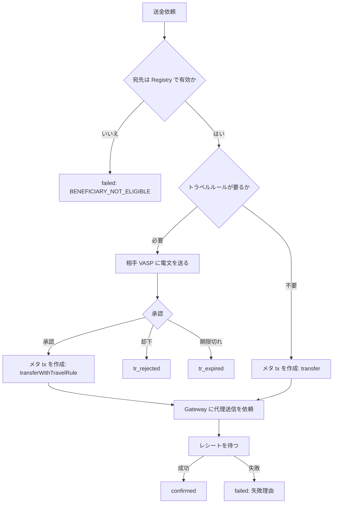

# 05 VASP サービス

## 1. 役割

VASP 1 社分のバックエンド。同じコードを VASP A（`vasp-a`）と VASP B（`vasp-b`）として 2 つ起動する。

| 機能 | 内容 | 要件 |
|---|---|---|
| 顧客管理と KYC | 申込の受付、承認、アドレスの発行と Registry への登録 | 7, 15 |
| 鍵の保管と署名 | 顧客の秘密鍵を暗号化して保管し、メタトランザクションに署名する | 22 |
| ウォレット | 残高、履歴、送金、交換 | 2, 3 |
| トラベルルール | 相手 VASP との電文交換、受取人の照合、承認への署名 | 11 |
| レート提示 | 署名付き Quote を出す（VASP B だけ） | 3 |
| AML | 取引の監視（モック）、アラート、凍結申請 | 10, 13 |
| 開示 | 監査者からの開示請求への応答 | 12 |

個人情報を持つのはこのサービスだけ。ほかのサービスとチェーンには渡さない。例外は 2 つ。

- トラベルルールの電文を相手 VASP に送るとき。
- 承認した開示請求に対して、監査ツールに氏名を返すとき。

## 2. 認証

| 相手 | 方式 |
|---|---|
| ユーザー画面 | `POST /v1/session` が返すトークンを `Authorization: Bearer` で送る。DevNet ではメールアドレスだけで発行する。有効期間は 24 時間 |
| VASP 管理画面 | 環境変数 `ADMIN_TOKEN` を `Authorization: Bearer` で送る |
| 相手 VASP | 署名付きリクエスト（下記） |
| 監査ツール | 環境変数 `AUDITOR_API_KEY` を `Authorization: Bearer` で送る |

署名付きリクエスト。VASP 間 API と、VASP からコンソーシアムへの申請で使う。実装は `packages/shared/src/http-signature.ts`。

| ヘッダー | 値 |
|---|---|
| `X-Ledgera-Vasp-Id` | 送信側の VASP ID |
| `X-Ledgera-Timestamp` | UNIX 秒 |
| `X-Ledgera-Signature` | 下の文字列に対する EIP-191 署名 |

```
<HTTP メソッド>\n<パス>\n<タイムスタンプ>\n<keccak256(ボディ) の 16 進>
```

HTTP メソッドは大文字。パスは送信先 URL のエンコード済み `pathname`。
タイムスタンプは先頭ゼロのない 10 進。ハッシュは `0x` 付きの小文字 16 進 64 桁。
各行を LF で区切る。最終行はハッシュの末尾で終わる。
署名は 65 バイトの `r || s || v` を `0x` 付きの小文字 16 進で表す。low-s と `v = 27` または `28` を使う。

受信側の検証。

- 署名から復元したアドレスが `KycRegistry.travelRuleSignerOf(vaspId)` と一致する。
- タイムスタンプが現在から前後 300 秒以内。
- クエリがあれば拒否する。ボディは受信したバイト列をそのままハッシュにする。
- 送信側の VASP が `ACTIVE`。

相手 VASP の URL は `KycRegistry.getVasp(vaspId).endpoint` から得る。設定ファイルには書かない。

## 3. 顧客と KYC

### 3.1 状態

| `kyc_status` | 意味 |
|---|---|
| `pending` | 申込済み。審査待ち |
| `approved` | 承認済み。アドレスが Registry に登録されている |
| `rejected` | 却下 |
| `error` | 承認操作の途中で失敗。再実行できる |

### 3.2 承認の処理

1. 秘密鍵を乱数で生成する。
2. AES-256-GCM で暗号化して `wallets` に保存する。鍵は `VASP_KEY_ENCRYPTION_KEY`。顧客 ID とアドレスを認証データに含める。
3. `KycRegistry.registerAccount(address, CUSTOMER, validUntil)` を組み立てる。`validUntil` は現在 + `KYC_VALIDITY_DAYS` 日。
4. VASP 管理者の鍵で署名し、Gateway の `/rpc` に送る。
5. レシートを待つ。成功なら `approved`、失敗なら `error`。

登録の署名済み取引は送信前に保存する。応答を確認できない場合は、同じ取引ハッシュで L2 と Gateway を照合する。
管理者の nonce が finalized ブロックで進んでいれば、そのブロックから親ハッシュをたどって nonce を使った取引を探す。別の取引が見つかった場合は登録を失敗にする。
Gateway が受け付けた取引の取り込みを確認できない間は、取引ハッシュと待機時間をログに出す。Sequencer が保持していない取引は Gateway が再送する。

- 審査そのものは人が画面で承認する。書類の確認は行わない。
- 顧客が自分のアドレスを持ち込む経路はない。アドレスは必ず VASP が発行する。

## 4. 送金

### 4.1 処理の流れ



- 宛先の確認は `KycRegistry.isHolder(to)` で行う。
- トラベルルールの要否は `TravelRuleCompliance.requiresTravelRule(from, to)` で判定する。
- `DEMO_MODE` のとき、この 2 つを飛ばす指定ができる（8.3）。チェーンが拒否することを見せるため。

### 4.2 状態

| `status` | 意味 |
|---|---|
| `created` | 受付済み |
| `tr_pending` | 相手 VASP の承認待ち |
| `tr_approved` | 承認を受領 |
| `submitted` | Gateway が受け付けた。通番あり |
| `confirmed` | L2 のブロックに入り、成功 |
| `tr_rejected`、`tr_expired`、`failed` | 終了。`error_code` に理由 |

### 4.3 メタトランザクションの作成

1. `LedgerForwarder.nonces(顧客アドレス)` を読む。
2. `ForwardRequest` を組み立てる。`deadline` は現在 + 300 秒。
3. 顧客の秘密鍵を復号し、EIP-712 で署名する。
4. Gateway の `POST /relay/v1/forward` に送る。API キーは `GATEWAY_API_KEY`。`DEMO_MODE` のときは `submitOnRevert: true` を付ける。
5. 返ってきた `txHash` と Receipt の `seq` を保存する。
6. 追跡済みの L2 ブロックでレシートを確認する。署名済みの依頼と一致する取引が成功し、指定した送金の `Transfer` があれば `confirmed` にする。失敗したレシートの位置とエラーは、`submitted` のまま記録する。

Gateway Receipt がある場合は、Sequencer への転送が拒否されても L2 を照合する。L2 で成功を確認できない場合は、finalized ブロックまで照合する。署名期限を過ぎ、署名者の nonce が消費されていなければ `failed` にする。nonce が消費されていれば、`ExecutedForwardRequest` の取引を照合する。同じ署名者と nonce の実行が成功し、その実行のログ範囲に指定した移転があれば、そのレシートで確定する。

`failed` のときの `error_code`。

| 場合 | `error_code` |
|---|---|
| Gateway が 422 `SIMULATION_REVERTED` を返した（取引は送られていない） | `details` の `errorName`。復号できなければ `REVERTED` |
| Gateway の応答の `simulation.reverted` が true で、L2 でも失敗した | `simulation.errorName`。復号できなければ `REVERTED` |
| シミュレーションは通ったが L2 で失敗した | `REVERTED` |
| 宛先、送信元、金額が一致する `Transfer` が見つからない | `TRANSFER_EFFECT_MISSING` |
| finalized ブロックで署名が失効した | `FORWARD_REQUEST_EXPIRED`。転送拒否の記録がある場合は `FORWARD_REJECTED` |
| Gateway がその他の確定したエラーを返した | Gateway のエラーコード |

`gas`（呼び出し先に渡すガス）の値。

| 呼び出し | `gas` |
|---|---:|
| `transfer` | 200,000 |
| `transferWithTravelRule` | 300,000 |
| `approve` | 100,000 |
| `AtomicSwap.fill` | 500,000 |

### 4.4 同時実行の制限

- 1 人の顧客が同時に実行できる送金と交換は 1 件。
- 終了していない操作がある間は、新しい依頼を 409 `OPERATION_IN_PROGRESS` で拒否する。
- 理由。`LedgerForwarder` の nonce は署名者ごとの連番で、署名した順にしか実行できない。

### 4.5 入金の検知

- 2 秒ごとに、未処理のブロックを番号順に処理する。
- ブロックごとに `eth_getBlockByNumber` と、ブロックハッシュを指定した `eth_getLogs` を呼ぶ。両トークンの `Transfer` のうち、宛先が自社顧客のものを `transfers` に `direction = 'in'` で記録する。
- 記録には、ブロック番号、ブロックハッシュ、ログの位置（`log_index`）を持たせる。
- 同じ取引の `TravelRuleTransfer` イベントから `refId` を取り、受信した電文と結びつける。
- 処理済みブロックの番号とハッシュは `processed_blocks` に持つ。`finalized` より古い行は消す。

### 4.6 再編成への対応

unsafe ブロックは消えることがある。原因は Sequencer の切替と、op-reth のデータ消失（02 章 13 節）。VASP の記録をチェーンに合わせ直す。

検出。Indexer と同じ手順（07 章 2.1）。

- 取得したブロックの `parentHash` が、`processed_blocks` の 1 つ前のハッシュと違えば再編成とみなす。
- ハッシュが一致する高さ（分岐点）まで遡る。分岐点より上の `processed_blocks` を消し、ブロックを処理し直す。

分岐点より上のブロックに依存する記録の扱い。

| 記録 | 扱い |
|---|---|
| 入金（`transfers`、`direction = 'in'`） | `status` を `reorged` にする。処理し直して同じ移転が見つかれば、新しい位置で行を作る |
| 送金、交換（`confirmed`、`failed`） | `submitted` に戻し、レシートを待ち直す。取引は Gateway が送り直す（04 章 7.2） |
| KYC の承認（`approved`） | `registerAccount` のレシートを待ち直す。成功でなければ `error` にする |
| アラート | 根拠の入金（`alerts.transfer_id`）が `reorged` になったら、下の表のとおりにする |

根拠の入金が消えたアラートの扱い。

| 元の状態 | 扱い |
|---|---|
| `open` | `invalidated` にする |
| `freeze_requested` | `invalidated` にする。コンソーシアムサービスに申請の取り下げを依頼する（06 章 4.4） |
| `frozen` | 状態は変えない。`evidence_reorged` を true にする。遮断を解くかは VASP 管理者が判断し、`UNBLOCK_ACCOUNT` を申請する |
| `closed` | 変えない |

- 処理し直して同じ入金がまた見つかれば、新しい行に対して AML の規則を評価し直す。該当すれば新しいアラートを作る。
- `finalized` のブロックは再編成されない。`finalized` より古い記録は対象にしない。

## 5. トラベルルール

### 5.1 電文

IVMS101 の項目名に合わせた簡略形。

```json
{
  "refId": "0x9f…（乱数 32 バイト）",
  "originatorVaspId": 1,
  "beneficiaryVaspId": 2,
  "token": "0x…",
  "amount": "10000000000",
  "expiry": 1795000600,
  "originator": {
    "address": "0x…",
    "naturalPerson": {
      "name": { "primaryIdentifier": "佐藤", "secondaryIdentifier": "太郎" },
      "dateOfBirth": "1985-04-01",
      "geographicAddress": { "country": "JP", "addressLine": "東京都千代田区…" },
      "customerIdentification": "A-000123"
    }
  },
  "beneficiary": {
    "address": "0x…",
    "naturalPerson": {
      "name": { "primaryIdentifier": "Lim", "secondaryIdentifier": "Wei" }
    }
  }
}
```

- `refId` は送付側が乱数で作る。電文の内容のうち、承認とイベントに含まれるのはこの値だけ。
- 受取人の氏名は、送金依頼のときにユーザーが入力する。電文が必要な送金で氏名がなければ、`BENEFICIARY_NAME_REQUIRED` を記録する。
- 送付側は参照 ID と電文を送信前に保存する。同じ送付 VASP が同じ電文を再送した場合は、保存済みの応答を返す。同じ参照 ID で本文が異なる場合は 409 とする。

### 5.2 VASP 間 API

すべて署名付きリクエスト。受取 VASP は応答にも同じ署名ヘッダーを付ける。

応答署名の対象は `ledgerA-http-response-v1`、リクエストの EIP-191 ダイジェスト、HTTP ステータス、応答の UNIX 時刻（秒）、生の応答本文の Keccak-256 を改行で結んだ文字列。ステータスと時刻は 10 進。本文がない `204` は空バイト列を使う。送付側は Registry の受取 VASP の鍵で応答を検証する。

| メソッド | パス | 送信側 | 内容 |
|---|---|---|---|
| POST | `/vasp/v1/travel-rule/transfers` | 送付 VASP | 電文を送る |
| GET | `/vasp/v1/travel-rule/transfers/:refId` | 送付 VASP | 状態と承認を取得する |
| POST | `/vasp/v1/travel-rule/transfers/:refId/confirm` | 送付 VASP | 送金後に取引ハッシュを知らせる |

`POST` と `GET` の応答。

```json
{
  "refId": "0x…",
  "status": "approved",
  "attestation": {
    "refId": "0x…",
    "originator": "0x…",
    "beneficiary": "0x…",
    "token": "0x…",
    "amount": "10000000000",
    "originatorVaspId": 1,
    "beneficiaryVaspId": 2,
    "expiry": 1795000600
  },
  "signature": "0x…"
}
```

`status` は `pending`、`approved`、`rejected`。`attestation` と `signature` は `approved` のときだけ入る。

### 5.3 受取側の処理

1. 署名付きリクエストを検証する。
2. `beneficiaryVaspId` が自社である。
3. `beneficiary.address` が自社の顧客で、`KycRegistry.isHolder` が true。満たさなければ `rejected`。
4. 受取人の氏名を自社の KYC 情報と照合する。結果を `name_match` に記録する。不一致でも自動では却下しない。
5. `pending` で保存する。
6. 承認する。
   - デモ設定の `TRAVEL_RULE_AUTO_APPROVE=true` なら、手順 3 を通った時点で承認する。氏名が一致しなくても、その結果は `name_match` に記録する。
   - false なら、VASP 管理者が画面で承認か却下を選ぶ。
7. 承認時に `TravelRuleAttestation` を作り、署名用の鍵（`VASP_SIGNER_PRIVATE_KEY`）で EIP-712 署名する。

### 5.4 送付側の処理

1. 電文を作り、相手 VASP に `POST` する。
2. `approved` か `rejected` になるまで、2 秒ごとに `GET` する。
3. `expiry` を過ぎたら `tr_expired` にする。
4. `approved` を受け取ったら、承認と署名を `transferWithTravelRule` の引数にする。
5. 送金が `confirmed` になったら `confirm` を送る。受取側は参照 ID と送金のイベントを照合する。

`expiry` は現在 + `TRAVEL_RULE_TTL_SEC`（既定 600 秒、上限 86,400 秒）。受取側はリクエストの署名時刻から 86,400 秒を超える期限を拒否する。

## 6. 交換

### 6.1 役割分担

| 役 | 担当 | 処理 |
|---|---|---|
| taker | 利用者が属する VASP | 見積もりの取得、利用者の署名、代理送信の依頼 |
| maker | `MARKET_MAKER_ENABLED=true` の VASP（VASP B） | レートの決定、Quote への署名 |

### 6.2 見積もり

VASP 間 API（署名付きリクエスト）。

`POST /vasp/v1/rfq/quotes`

```json
{
  "taker": "0x…",
  "takerToken": "0x…（tJPY）",
  "makerToken": "0x…（tUSD）",
  "makerAmount": "10000000000"
}
```

- `makerAmount` と `takerAmount` のどちらか一方を指定する。
- maker は `RFQ_RATE_JPY_PER_USD`（既定 155.20）でもう一方を計算する。端数は taker の支払いが増える側に丸める。
- `expiry` は現在 + `RFQ_TTL_SEC`（30 秒）。`nonce` は乱数。
- maker は自己勘定の鍵（`TREASURY_PRIVATE_KEY`）で Quote に署名し、`quotes_issued` に保存する。

応答。

```json
{
  "quote": {
    "maker": "0x…", "taker": "0x…",
    "makerToken": "0x…", "takerToken": "0x…",
    "makerAmount": "10000000000", "takerAmount": "1552000000000",
    "expiry": 1795000030, "nonce": "0x…"
  },
  "signature": "0x…"
}
```

### 6.3 実行

1. 利用者が見積もりを確定する。
2. taker の VASP が利用者の鍵で 2 つの `ForwardRequest` に署名する。
   - nonce n: `takerToken.approve(AtomicSwap, takerAmount)`
   - nonce n + 1: `AtomicSwap.fill(quote, makerSignature)`
3. 2 件を 1 回の `POST /relay/v1/forward` で送る。Gateway が `executeAll` で 1 取引にする。
4. 正規ブロックの `Filled` イベントを Quote のダイジェストと照合してから `confirmed` にする。L2 で失敗した場合も、署名期限または nonce の消費が確定するまで操作枠を保持する。

期限切れの見積もりは、通常は送らずに 409 `QUOTE_EXPIRED` で拒否する。`DEMO_MODE` のときは、期限切れでも送る指定ができる（8.3）。L2 上で `QuoteExpired` として失敗し、両方の残高が変わらないことを見せる。

## 7. AML と凍結

### 7.1 監視規則（モック）

入金を検知した時点で評価する。対象は、送り手の種別が `CUSTOMER` の入金だけ。発行と交換は対象にしない。

| 規則 | 条件 | 設定 |
|---|---|---|
| `LARGE_AMOUNT` | 金額がしきい値以上 | `AML_THRESHOLD_TUSD`（既定 5,000）、`AML_THRESHOLD_TJPY`（既定 500,000） |
| `WATCHLIST` | 受け取った顧客の氏名が一覧に含まれる | `AML_WATCHLIST`（カンマ区切り） |

該当したら `alerts` に `open` で記録する。根拠の入金を `transfer_id` に持つ。

アラートの状態。

| `status` | 意味 |
|---|---|
| `open` | 未対応 |
| `freeze_requested` | コンソーシアムに凍結を申請した |
| `frozen` | 申請が実行され、アドレスが `BLOCKED` になった |
| `closed` | 対応なしで閉じた。申請が取り下げられた場合も含む |
| `invalidated` | 根拠の入金が再編成で消えた（4.6） |

### 7.2 VASP 管理者の操作

| 操作 | 処理 |
|---|---|
| 自社で停止 | `KycRegistry.suspendAccount(address, reason)` を VASP 管理者の鍵で送る |
| 停止の解除 | `KycRegistry.reinstateAccount(address)` |
| 凍結を申請 | コンソーシアムサービスの `POST /v1/proposals` を署名付きリクエストで呼ぶ。種別は `BLOCK_ACCOUNT` |
| アラートを閉じる | 凍結申請を準備していない `open` のアラートを `closed` にする |

- `reason` は乱数 32 バイト。アラートの ID と対応づけて DB に持つ。
- 申請後はコンソーシアムサービスの申請 ID を `alerts.proposal_id` に保存し、状態を `freeze_requested` にする。
- 5 秒ごとに申請の状態を読む。`executed` なら `frozen`、`cancelled` なら `closed` にする。`failed` と `cancelling` の間は `freeze_requested` のままにする。申請がまだチェーン上で実行できるため（06 章 3 節）。
- 申請の取り下げの依頼は、管理者の操作ではなく、再編成の検出時にサービスが自動で送る。コンソーシアムサービスの `POST /v1/proposals/:id/withdrawal-request` を署名付きリクエストで呼ぶ。

## 8. API

### 8.1 ユーザー向け

| メソッド | パス | 内容 |
|---|---|---|
| POST | `/v1/customers` | 口座開設の申込 |
| POST | `/v1/session` | トークンの発行 |
| GET | `/v1/me` | 顧客情報、KYC の状態、アドレス |
| GET | `/v1/me/balances` | トークン残高（L2 から読む） |
| GET | `/v1/me/transfers` | 送金と入金の履歴 |
| POST | `/v1/me/transfers` | 送金の依頼 |
| GET | `/v1/me/transfers/:id` | 送金の状態 |
| POST | `/v1/me/swaps/quote` | 交換の見積もり |
| POST | `/v1/me/swaps` | 交換の実行 |
| GET | `/v1/me/swaps` | 交換の履歴 |
| GET | `/v1/me/swaps/:id` | 交換の状態 |

`POST /v1/customers`

```json
{
  "familyName": "佐藤", "givenName": "太郎",
  "dateOfBirth": "1985-04-01",
  "country": "JP", "addressLine": "東京都千代田区…",
  "email": "sato@example.com"
}
```

`POST /v1/me/transfers`

```json
{
  "toAddress": "0x…",
  "token": "tUSD",
  "amount": "10000000000",
  "beneficiaryName": { "primaryIdentifier": "Lim", "secondaryIdentifier": "Wei" }
}
```

応答。

```json
{
  "id": "tr_01J…",
  "status": "tr_pending",
  "refId": "0x…",
  "txHash": null,
  "gatewaySeq": null,
  "errorCode": null
}
```

`POST /v1/me/swaps/quote`

```json
{ "sellToken": "tJPY", "buyToken": "tUSD", "buyAmount": "10000000000" }
```

応答。

```json
{
  "quoteId": "q_01J…",
  "sellAmount": "1552000000000",
  "buyAmount": "10000000000",
  "rate": "155.20",
  "expiresAt": "2026-11-19T03:00:30Z"
}
```

`POST /v1/me/swaps`

```json
{ "quoteId": "q_01J…" }
```

### 8.2 VASP 管理者向け

| メソッド | パス | 内容 |
|---|---|---|
| GET | `/v1/admin/customers` | 顧客の一覧 |
| POST | `/v1/admin/customers/:id/kyc/approve` | KYC の承認 |
| POST | `/v1/admin/customers/:id/kyc/reject` | KYC の却下 |
| POST | `/v1/admin/customers/:id/suspend` | 自社で停止 |
| POST | `/v1/admin/customers/:id/reinstate` | 停止の解除 |
| GET | `/v1/admin/travel-rule?direction=in\|out` | 電文の一覧 |
| POST | `/v1/admin/travel-rule/:refId/approve` | 受信した電文の承認 |
| POST | `/v1/admin/travel-rule/:refId/reject` | 受信した電文の却下 |
| GET | `/v1/admin/alerts` | アラートの一覧 |
| POST | `/v1/admin/alerts/:id/request-freeze` | 凍結の申請 |
| POST | `/v1/admin/alerts/:id/close` | アラートを閉じる |
| GET | `/v1/admin/disclosure-requests` | 開示請求の一覧 |
| POST | `/v1/admin/disclosure-requests/:id/approve` | 開示の承認 |
| POST | `/v1/admin/disclosure-requests/:id/reject` | 開示の却下 |
| GET | `/v1/admin/addresses` | 自社のアドレスと顧客名の対応 |

`GET /v1/admin/addresses` は、チェーン表示の「VASP の DB にある情報」の列に使う。

### 8.3 デモ用の指定

`DEMO_MODE=true` のときだけ受け付ける。

| API | 追加のフィールド | 効果 |
|---|---|---|
| `POST /v1/me/transfers` | `"demo": { "skipChecks": true }` | 宛先の事前確認とトラベルルールを飛ばし、`transfer` をそのまま送る |
| `POST /v1/me/swaps` | `"demo": { "allowExpired": true }` | 期限切れの見積もりでも送る |

`DEMO_MODE=true` のときは、すべての送金と交換で Gateway に `submitOnRevert: true` を付ける。失敗する取引も L2 に入り、チェーンが拒否した記録が残る。凍結された利用者の送金（デモ場面 5）もこれで L2 上の失敗取引になる。

### 8.4 VASP 間、監査ツール向け

| メソッド | パス | 相手 | 内容 |
|---|---|---|---|
| POST | `/vasp/v1/travel-rule/transfers` | VASP | 5.2 |
| GET | `/vasp/v1/travel-rule/transfers/:refId` | VASP | 5.2 |
| POST | `/vasp/v1/travel-rule/transfers/:refId/confirm` | VASP | 5.2 |
| POST | `/vasp/v1/rfq/quotes` | VASP | 6.2 |
| POST | `/vasp/v1/disclosure-requests` | 監査ツール | 開示請求の受付 |
| GET | `/vasp/v1/disclosure-requests/:id` | 監査ツール | 状態と、承認済みなら開示内容 |

開示請求。

```json
{ "address": "0x…", "reason": "AML アラートの調査", "requestedBy": "auditor" }
```

状態は `pending`、`approved`、`rejected` のいずれか。承認時点の氏名と顧客 ID を保存する。承認前と却下後の応答は、ID と状態だけを返す。

承認後の `GET` の応答。

```json
{
  "id": "dr_01J…",
  "status": "approved",
  "disclosure": {
    "address": "0x…",
    "customerIdentification": "B-000045",
    "name": { "primaryIdentifier": "Lim", "secondaryIdentifier": "Wei" }
  }
}
```

## 9. DB スキーマ

スキーマ名は `vasp_a`、`vasp_b`。

`customers`

| 列 | 型 | 説明 |
|---|---|---|
| `id` | text、主キー | `A-000123` の形式 |
| `family_name`、`given_name` | text | |
| `date_of_birth` | date | |
| `country`、`address_line` | text | |
| `email` | text、一意 | |
| `kyc_status` | text | 3.1 |
| `created_at`、`updated_at` | timestamptz | |

`wallets`

| 列 | 型 | 説明 |
|---|---|---|
| `customer_id` | text、主キー | |
| `address` | bytea、一意 | |
| `encrypted_private_key` | bytea | nonce ‖ 暗号文 ‖ タグ |
| `registered_tx_hash` | bytea、null 可 | `registerAccount` の取引 |
| `registered_block_number` | bigint、null 可 | 取り込まれたブロック |
| `registered_block_hash` | bytea、null 可 | 同上。再編成の照合に使う |
| `valid_until` | timestamptz | |

`transfers`

| 列 | 型 | 説明 |
|---|---|---|
| `id` | text、主キー | |
| `customer_id` | text | |
| `direction` | text | `out`、`in` |
| `counterparty_address` | bytea | |
| `counterparty_vasp_id` | integer、null 可 | |
| `token` | bytea | |
| `amount` | numeric(78,0) | |
| `status` | text | 4.2。入金は `confirmed` か `reorged` |
| `ref_id` | bytea、null 可 | トラベルルールの参照 ID |
| `tx_hash` | bytea、null 可 | |
| `block_number` | bigint、null 可 | 取り込まれたブロック |
| `block_hash` | bytea、null 可 | 同上。再編成の照合に使う |
| `log_index` | integer、null 可 | 入金だけ。`Transfer` のログの位置 |
| `gateway_seq` | bigint、null 可 | |
| `error_code` | text、null 可 | |
| `created_at`、`updated_at` | timestamptz | |

入金は（`block_hash`、`log_index`）で一意にする。

`travel_rule_messages`

| 列 | 型 | 説明 |
|---|---|---|
| `ref_id` | bytea、主キー | |
| `direction` | text | `out`、`in` |
| `counterparty_vasp_id` | integer | |
| `payload` | jsonb | 電文（個人情報を含む） |
| `status` | text | `pending`、`approved`、`rejected`、`expired` |
| `name_match` | boolean、null 可 | 受信側だけ |
| `attestation` | jsonb、null 可 | |
| `signature` | bytea、null 可 | |
| `tx_hash` | bytea、null 可 | |
| `created_at`、`decided_at` | timestamptz | |

`swaps`

| 列 | 型 | 説明 |
|---|---|---|
| `id` | text、主キー | |
| `customer_id` | text | |
| `quote` | jsonb | |
| `maker_signature` | bytea | |
| `status` | text | `quoted`、`submitted`、`confirmed`、`failed`、`expired` |
| `tx_hash` | bytea、null 可 | |
| `block_number` | bigint、null 可 | 取り込まれたブロック |
| `block_hash` | bytea、null 可 | 同上。再編成の照合に使う |
| `gateway_seq` | bigint、null 可 | |
| `error_code` | text、null 可 | |
| `created_at`、`updated_at` | timestamptz | |

`quotes_issued`（maker 側）

| 列 | 型 |
|---|---|
| `nonce` | numeric(78,0)、主キー |
| `quote` | jsonb |
| `signature` | bytea |
| `requested_by_vasp_id` | integer |
| `expires_at` | timestamptz |
| `filled_tx_hash` | bytea、null 可 |

`alerts`

| 列 | 型 |
|---|---|
| `id` | text、主キー |
| `customer_id` | text |
| `address` | bytea |
| `rule` | text |
| `detail` | jsonb |
| `transfer_id` | text（根拠の入金。`transfers.id`） |
| `status` | text（`open`、`freeze_requested`、`frozen`、`closed`、`invalidated`） |
| `evidence_reorged` | boolean（`frozen` の後に根拠の入金が消えたら true） |
| `reason_id` | bytea |
| `proposal_id` | text、null 可 |
| `created_at` | timestamptz |

`disclosure_requests`

| 列 | 型 |
|---|---|
| `id` | text、主キー |
| `address` | bytea |
| `requested_by` | text |
| `reason` | text |
| `status` | text（`pending`、`approved`、`rejected`） |
| `disclosure` | jsonb、承認以外は null |
| `created_at`、`decided_at` | timestamptz |

`sessions`（`token`、`customer_id`、`expires_at`）、`processed_blocks`（`block_number`、`block_hash`）も持つ。

## 10. 設定

| 環境変数 | 既定 | 説明 |
|---|---|---|
| `PORT` | 8621 / 8622 | |
| `DATABASE_URL` | - | |
| `DEPLOYMENTS_FILE` | - | |
| `L2_RPC_URL` | - | 読み取り用。rpc-proxy を指す |
| `GATEWAY_URL`、`GATEWAY_API_KEY` | - | |
| `CONSORTIUM_URL` | - | |
| `VASP_ID` | - | 1 か 2 |
| `VASP_NAME` | - | 画面表示用 |
| `CUSTOMER_ID_PREFIX` | - | `A` か `B` |
| `VASP_ADMIN_PRIVATE_KEY` | - | Registry の更新 |
| `VASP_SIGNER_PRIVATE_KEY` | - | 承認と VASP 間 API の署名 |
| `VASP_KEY_ENCRYPTION_KEY` | - | 32 バイトの 16 進 |
| `ADMIN_TOKEN`、`AUDITOR_API_KEY` | - | |
| `KYC_VALIDITY_DAYS` | 365 | |
| `TRAVEL_RULE_AUTO_APPROVE` | false | |
| `TRAVEL_RULE_TTL_SEC` | 600 | |
| `MARKET_MAKER_VASP_ID` | 2 | 見積もりの依頼先 |
| `MARKET_MAKER_ENABLED` | false | VASP B は true |
| `TREASURY_PRIVATE_KEY` | - | maker だけ |
| `RFQ_RATE_JPY_PER_USD` | 155.20 | maker だけ |
| `RFQ_TTL_SEC` | 30 | maker だけ |
| `AML_THRESHOLD_TUSD` | 5000 | |
| `AML_THRESHOLD_TJPY` | 500000 | |
| `AML_WATCHLIST` | 空 | |
| `DEMO_MODE` | false | 8.3 |

## 11. テスト

| 種類 | 内容 |
|---|---|
| 単体 | 鍵の暗号化と復号。レート計算の丸め。署名付きリクエストの検証 |
| 単体 | 送金の状態遷移。同時実行の制限 |
| 結合（anvil、2 インスタンス） | KYC 承認で Registry に登録される |
| 結合 | 同一 VASP 内の送金が電文なしで成功する |
| 結合 | VASP をまたぐ送金: 電文、手動承認、`transferWithTravelRule`、入金検知、`confirm` |
| 結合 | 却下と期限切れで送金が止まる |
| 結合 | 交換: 見積もり、実行、両残高の入れ替わり。期限切れの見積もりで残高が変わらない |
| 結合 | 高額の入金でアラートが出る。凍結申請がコンソーシアムに届く |
| 結合 | 遮断された顧客の送金と交換が `SignerNotAllowed` で `failed` になる |
| 結合 | 再編成（anvil の `evm_revert`）で入金のブロックが消えると、入金が `reorged`、アラートが `invalidated` になる |
| 結合 | `freeze_requested` のアラートの根拠が消えると、コンソーシアムに取り下げの依頼が届く |
| 結合 | 再編成で消えた送金が `submitted` に戻り、送り直された取引のレシートで `confirmed` になる |
| 結合 | 開示請求の承認で氏名が返る |
