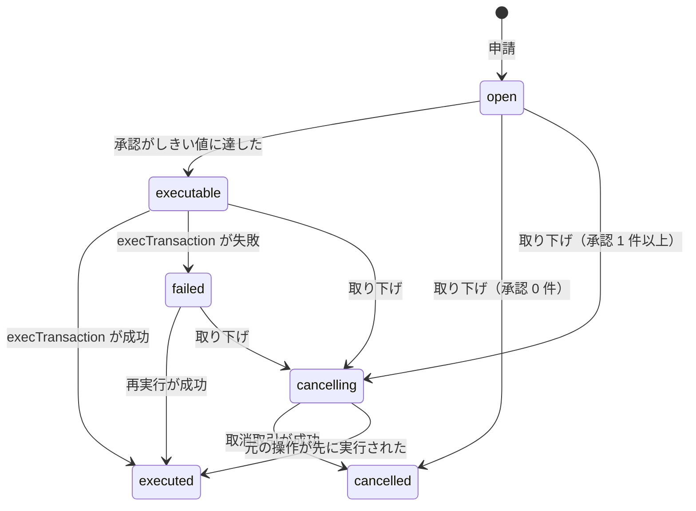

# 06 コンソーシアムサービス

## 1. 役割

Registry の更新を、複数者の承認を経て実行する（要件 13、14）。

| 機能 | 内容 |
|---|---|
| 申請の受付 | VASP と構成員から、Registry 更新の申請を受ける |
| 承認 | 構成員ごとに、`ConsortiumSafe.approveHash` を L2 に送る |
| 実行 | しきい値に達したら、`ConsortiumSafe.execTransaction` を L2 に送る |
| 取り下げ | 承認が L2 にある申請は、取消取引を実行して失効させる |

- 申請と審査の記録はこのサービスの DB に持つ。承認、実行、取り下げの事実は L2 に残る。
- 構成員 3 者の鍵は、DevNet ではこのサービスが環境変数で持つ。画面で構成員を切り替えて操作する。
- 承認の状態は L2 を正とする。DB の値は表示用の写し。

## 2. 申請の種別

| `type` | `params` | 実行する呼び出し |
|---|---|---|
| `BLOCK_ACCOUNT` | `account`、`reasonId` | `KycRegistry.blockAccount(account, reasonId)` |
| `UNBLOCK_ACCOUNT` | `account` | `KycRegistry.unblockAccount(account)` |
| `REGISTER_VASP` | `vaspId`、`admin`、`travelRuleSigner`、`name`、`endpoint` | `KycRegistry.registerVasp(...)` |
| `SET_VASP_STATUS` | `vaspId`、`status` | `KycRegistry.setVaspStatus(vaspId, status)` |
| `REGISTER_OPERATOR_ACCOUNT` | `account`、`vaspId`、`kind` | `KycRegistry.registerOperatorAccount(...)` |
| `RAW` | `to`、`data` | 任意の呼び出し |

申請できる者。

| 申請者 | 認証 | 申請できる種別 |
|---|---|---|
| VASP | 署名付きリクエスト（05 章 2 節） | `BLOCK_ACCOUNT`、`UNBLOCK_ACCOUNT` |
| 構成員 | `ADMIN_TOKEN` | すべて |

- `reasonId` は乱数 32 バイト。L2 に記録されるのはこの値だけ。
- 申請理由の文章（`reason`）は DB にだけ持つ。個人情報を書かない運用にする。画面に注意書きを出す。

## 3. 状態



各状態が L2 上で意味すること。

| 状態 | L2 上の状態 |
|---|---|
| `open` | 承認がしきい値に達していない |
| `executable` | しきい値の数の `approveHash` が記録されている。nonce は未消費 |
| `failed` | `execTransaction` が revert した。nonce は未消費で、承認は有効なまま。内側の呼び出しが通る状態になれば実行できる |
| `cancelling` | 取消取引の承認を集めている。元の操作はまだ実行できる |
| `cancelled` | 元の操作は実行できない。承認が 1 件もないか、取消取引で nonce が消費された |
| `executed` | 元の操作が実行された |

- 終了状態は `executed` と `cancelled` の 2 つ。どちらも、その申請の承認が L2 で使えなくなった状態を指す。
- `failed` は終了状態にしない。承認が L2 に残り、後から実行できるため。再実行するか、取り下げる。
- 未完了（`open`、`executable`、`failed`、`cancelling`）の申請は同時に 1 件まで。2 件目は 409 `PROPOSAL_IN_PROGRESS` で拒否する。Safe の nonce が申請ごとに 1 つ進むため、並行させると後続のハッシュが無効になる。

## 4. 処理

### 4.1 申請

1. `type` と `params` から `to` と `data` を作る。
2. `ConsortiumSafe.nonce()` を読む。
3. `ConsortiumSafe.getTransactionHash(to, 0, data, 0, 0, 0, 0, address(0), address(0), nonce)` で `safeTxHash` を得る。
4. `proposals` に保存する。

### 4.2 承認

1. 指定された構成員の鍵で `approveHash(safeTxHash)` に署名し、Gateway の `/rpc` に送る。
2. レシートを待つ。
3. `approvals` に取引ハッシュとブロック番号を保存する。
4. `ConsortiumSafe.approvedHashes(owner, safeTxHash)` を 3 者分読み、しきい値以上なら `executable` にする。

同じ構成員の 2 回目の承認は 409 `ALREADY_APPROVED`。

### 4.3 実行

1. 状態が `executable` か `failed` で、`safe_nonce` が現在の `ConsortiumSafe.nonce()` と一致することを確認する。満たさなければ 409 `NOT_EXECUTABLE` を返し、取引を送らない。
2. 承認済みの所有者をアドレスの昇順に並べ、署名を連結する（03 章 8.2）。
3. 指定された構成員の鍵で `execTransaction` に署名し、Gateway の `/rpc` に送る。
4. レシートが成功なら `executed`、失敗なら `failed`。

実行の条件は、`approveHash` が L2 でしきい値の数だけ記録されていること。Safe の仕様では、実行者自身の承認は `approveHash` なしでも数えられる。このサービスはそれを使わない。承認の取引を必ず L2 に残すため。

申請した VASP は `GET /v1/proposals/:id` を 5 秒ごとに読み、アラートの状態を更新する。

### 4.4 取り下げ

`cancelled` は「その申請の操作が L2 で実行できない」ことを保証する。DB の状態を変えるだけでは保証できない。L2 の承認（`approvedHashes`）は消せず、Safe の nonce が進むまで有効なため（03 章 8.2）。

| L2 上の承認の数 | 処理 |
|---|---|
| 0 件 | DB の状態を `cancelled` にする。L2 に取引を送らない |
| 1 件以上 | 取消取引を実行して nonce を消費する（下の手順） |

承認が 1 件でも取消取引が要る理由。Safe は実行者自身の承認を `approveHash` なしで数える。承認 1 件の申請は、別の構成員 1 人が `execTransaction` を送れば実行できる。

手順。取り下げにも 2 者の操作が要る。

1. 1 人目の構成員が `POST /v1/proposals/:id/cancel` を呼ぶ。
2. サービスは取消取引のハッシュ `cancelSafeTxHash` を計算して保存し、状態を `cancelling` にする。取消取引は `to` が `ConsortiumSafe` 自身、`value` が 0、`data` が空、nonce が申請の `safe_nonce`。
3. 1 人目の鍵で `approveHash(cancelSafeTxHash)` を Gateway の `/rpc` に送る。
4. 2 人目の構成員が同じ API を呼ぶ。2 人目の鍵で `approveHash(cancelSafeTxHash)` を送る。
5. 続けて、2 人目の鍵で取消取引の `execTransaction` を送る。
6. レシートが成功なら `cancelled`。Safe の nonce が 1 進み、元の `safeTxHash` は実行できなくなる。

- `cancelling` の間、元の操作の `POST /v1/proposals/:id/execute` は 409 `CANCELLING` で拒否する。
- `cancelling` の間も、元の操作は L2 では実行できる。このサービスを通さずに実行された場合は、4.5 の照合で `executed` にする。
- 取消の承認と実行も、`ApproveHash` と `ExecutionSuccess` として L2 に残る。

申請した VASP からの取り下げ依頼。

- 申請した VASP は `POST /v1/proposals/:id/withdrawal-request` を署名付きリクエストで呼べる。根拠の入金が再編成で消えたときに使う（05 章 4.6）。
- サービスは依頼の時刻と理由を保存する。取り下げそのものは行わない。構成員が画面で取り下げる。
- 依頼のある申請は、`execute` を 409 `WITHDRAWAL_REQUESTED` で拒否する。

### 4.5 L2 との照合

承認、実行、取り下げの状態は L2 を正とする。次の時点で L2 を読み直し、DB の状態を合わせる。

- 承認、実行、取り下げの各 API の先頭。
- 10 秒ごと。対象は未完了の申請と、`executed` か `cancelled` にした取引が `finalized` に達していない申請。

| L2 から読んだ内容 | DB の状態 |
|---|---|
| `nonce()` が `safe_nonce` と同じ。`approvedHashes(owner, safeTxHash)` がしきい値未満 | `open`。取消の承認が 1 件以上あれば `cancelling` |
| `nonce()` が `safe_nonce` と同じ。`approvedHashes(owner, safeTxHash)` がしきい値以上 | `executable`。`failed` と `cancelling` は変えない |
| `nonce()` が進んだ。`ExecutionSuccess(safeTxHash)` がある | `executed` |
| `nonce()` が進んだ。`ExecutionSuccess(cancelSafeTxHash)` がある | `cancelled` |

- 再編成で承認や実行の取引が消えた場合も、この照合で状態が戻る。消えた取引は Gateway が送り直す（04 章 7.2）。
- `approvals` の取引ハッシュとブロック番号も、`ApproveHash` イベントから取り直す。

## 5. API

| メソッド | パス | 認証 | 内容 |
|---|---|---|---|
| POST | `/v1/proposals` | VASP の署名、または `ADMIN_TOKEN` | 申請 |
| GET | `/v1/proposals?status=` | なし | 一覧 |
| GET | `/v1/proposals/:id` | なし | 詳細 |
| POST | `/v1/proposals/:id/approve` | `ADMIN_TOKEN` | 承認 |
| POST | `/v1/proposals/:id/execute` | `ADMIN_TOKEN` | 実行 |
| POST | `/v1/proposals/:id/cancel` | `ADMIN_TOKEN` | 取り下げ（4.4）。承認のある申請では 2 人が順に呼ぶ |
| POST | `/v1/proposals/:id/withdrawal-request` | 申請した VASP の署名 | 取り下げの依頼（4.4） |
| GET | `/v1/members` | なし | 構成員の一覧 |
| GET | `/v1/safe` | なし | Safe のアドレス、所有者、しきい値、nonce |

`POST /v1/proposals`

```json
{
  "type": "BLOCK_ACCOUNT",
  "params": { "account": "0x…", "reasonId": "0x…" },
  "reason": "AML アラート（高額受領）",
  "requestedBy": { "vaspId": 2 }
}
```

`POST /v1/proposals/:id/approve`、`/execute`、`/cancel`

```json
{ "memberId": 1 }
```

`POST /v1/proposals/:id/withdrawal-request`

```json
{ "reason": "根拠の入金が再編成で消えた" }
```

`GET /v1/proposals/:id`

```json
{
  "id": "p_01J…",
  "type": "BLOCK_ACCOUNT",
  "params": { "account": "0x…", "reasonId": "0x…" },
  "reason": "AML アラート（高額受領）",
  "requestedBy": { "vaspId": 2 },
  "status": "executable",
  "to": "0x4200000000000000000000000000000000000700",
  "data": "0x…",
  "safeNonce": "3",
  "safeTxHash": "0x…",
  "threshold": 2,
  "approvals": [
    { "memberId": 1, "address": "0x…", "txHash": "0x…", "blockNumber": "1200", "approvedAt": "2026-11-19T03:10:00Z" },
    { "memberId": 3, "address": "0x…", "txHash": "0x…", "blockNumber": "1204", "approvedAt": "2026-11-19T03:10:08Z" }
  ],
  "executedTxHash": null,
  "cancellation": null,
  "withdrawalRequest": null,
  "createdAt": "2026-11-19T03:09:30Z"
}
```

- `cancellation` は、取り下げ中か取り下げ済みのときに入る。内容は `cancelSafeTxHash`、取消の承認の一覧（`approvals` と同じ形）、`executedTxHash`。
- `withdrawalRequest` は、VASP から取り下げの依頼があるときに入る。内容は `requestedAt` と `reason`。

## 6. DB スキーマ

スキーマ名は `consortium`。

`proposals`

| 列 | 型 |
|---|---|
| `id` | text、主キー |
| `type` | text |
| `params` | jsonb |
| `reason` | text |
| `requested_by_vasp_id` | integer、null 可 |
| `requested_by_member_id` | integer、null 可 |
| `to_address` | bytea |
| `data` | bytea |
| `safe_nonce` | bigint |
| `safe_tx_hash` | bytea、一意 |
| `status` | text |
| `executed_tx_hash` | bytea、null 可 |
| `cancel_safe_tx_hash` | bytea、null 可 |
| `cancel_executed_tx_hash` | bytea、null 可 |
| `withdrawal_requested_at` | timestamptz、null 可 |
| `withdrawal_reason` | text、null 可 |
| `created_at`、`updated_at` | timestamptz |

`approvals`

| 列 | 型 |
|---|---|
| `proposal_id` | text |
| `member_id` | integer |
| `kind` | text（`execute` は元の操作の承認、`cancel` は取消取引の承認） |
| `member_address` | bytea |
| `tx_hash` | bytea |
| `block_number` | bigint |
| `approved_at` | timestamptz |

主キーは（`proposal_id`、`member_id`、`kind`）。

## 7. 設定

| 環境変数 | 既定 | 説明 |
|---|---|---|
| `PORT` | 8630 | |
| `DATABASE_URL` | - | |
| `DEPLOYMENTS_FILE` | - | |
| `L2_RPC_URL` | - | 読み取り用。rpc-proxy を指す |
| `GATEWAY_URL` | - | 書き込み用 |
| `CONSORTIUM_MEMBER_KEYS` | - | JSON 配列。秘密鍵 3 つ |
| `CONSORTIUM_MEMBER_NAMES` | `構成員 1,構成員 2,構成員 3` | 画面表示用 |
| `ADMIN_TOKEN` | - | |

## 8. テスト

| 種類 | 内容 |
|---|---|
| 単体 | 種別ごとの `data` の組み立て。署名の連結（昇順、`v = 1`） |
| 結合（anvil） | 申請、2 者の承認、実行で `KycRegistry` の状態が変わる |
| 結合 | 承認 1 件では実行できない |
| 結合 | 未完了の申請がある間、2 件目が拒否される |
| 結合 | 内側の呼び出しが失敗する申請（存在しないアカウントの遮断）が `failed` になる。未完了として残り、次の申請を受け付けない |
| 結合 | 承認 0 件の申請の取り下げは、L2 に取引を送らずに `cancelled` になる |
| 結合 | 承認 2 件の申請を取り下げると、Safe の nonce が 1 進む。元の `execTransaction` を L2 に直接送っても revert する |
| 結合 | 承認 1 件の申請の取り下げでも、取消取引が実行される |
| 結合 | `cancelling` の間、元の操作の実行が 409 で拒否される |
| 結合 | `failed` の申請を取り下げると、次の申請を受け付ける |
| 結合 | 再編成（anvil の `evm_revert`）で承認の取引が消えると、状態が `open` に戻る |
| 結合 | VASP の署名付き申請が受理される。別 VASP の鍵での署名が拒否される |
| 結合 | VASP の取り下げ依頼がある申請は実行できない。申請者でない VASP の依頼は拒否される |
