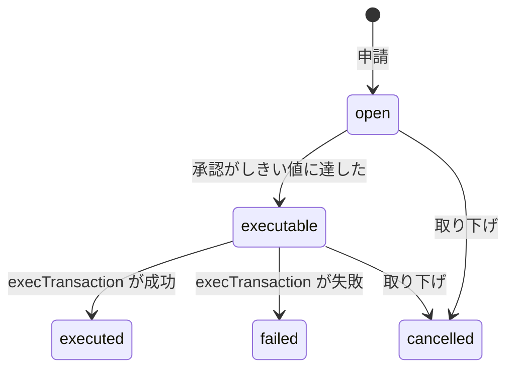

# 06 コンソーシアムサービス

## 1. 役割

Registry の更新を、複数者の承認を経て実行する（要件 13、14）。

| 機能 | 内容 |
|---|---|
| 申請の受付 | VASP と構成員から、Registry 更新の申請を受ける |
| 承認 | 構成員ごとに、`ConsortiumSafe.approveHash` を L2 に送る |
| 実行 | しきい値に達したら、`ConsortiumSafe.execTransaction` を L2 に送る |

- 申請と審査の記録はこのサービスの DB に持つ。承認と実行の事実は L2 に残る。
- 構成員 3 者の鍵は、DevNet ではこのサービスが環境変数で持つ。画面で構成員を切り替えて操作する。
- 承認の状態は L2 を正とする。DB の値は表示用の写し。

## 2. 申請の種別

| `type` | `params` | 実行する呼び出し |
|---|---|---|
| `BLOCK_ACCOUNT` | `account`、`reasonId` | `KycRegistry.blockAccount(account, reasonId)` |
| `UNBLOCK_ACCOUNT` | `account` | `KycRegistry.unblockAccount(account)` |
| `REGISTER_VASP` | `vaspId`、`admin`、`travelRuleSigner`、`name`、`endpoint` | `KycRegistry.registerVasp(...)` |
| `SET_VASP_STATUS` | `vaspId`、`status` | `KycRegistry.setVaspStatus(vaspId, status)` |
| `REGISTER_OPERATOR_ACCOUNT` | `account`、`vaspId`、`kind` | `KycRegistry.registerOperatorAccount(...)` |
| `RAW` | `to`、`data` | 任意の呼び出し |

申請できる者。

| 申請者 | 認証 | 申請できる種別 |
|---|---|---|
| VASP | 署名付きリクエスト（05 章 2 節） | `BLOCK_ACCOUNT`、`UNBLOCK_ACCOUNT` |
| 構成員 | `ADMIN_TOKEN` | すべて |

- `reasonId` は乱数 32 バイト。L2 に載るのはこの値だけ。
- 申請理由の文章（`reason`）は DB にだけ持つ。個人情報を書かない運用にする。画面に注意書きを出す。

## 3. 状態



未完了（`open` か `executable`）の申請は同時に 1 件まで。2 件目は 409 `PROPOSAL_IN_PROGRESS` で断る。Safe の nonce が申請ごとに 1 つ進むため、並行させると後続のハッシュが無効になる。

## 4. 処理

### 4.1 申請

1. `type` と `params` から `to` と `data` を作る。
2. `ConsortiumSafe.nonce()` を読む。
3. `ConsortiumSafe.getTransactionHash(to, 0, data, 0, 0, 0, 0, address(0), address(0), nonce)` で `safeTxHash` を得る。
4. `proposals` に保存する。

### 4.2 承認

1. 指定された構成員の鍵で `approveHash(safeTxHash)` に署名し、Gateway の `/rpc` に送る。
2. レシートを待つ。
3. `approvals` に取引ハッシュとブロック番号を保存する。
4. `ConsortiumSafe.approvedHashes(owner, safeTxHash)` を 3 者分読み、しきい値以上なら `executable` にする。

同じ構成員の 2 回目の承認は 409 `ALREADY_APPROVED`。

### 4.3 実行

1. 状態が `executable` で、`safe_nonce` が現在の `ConsortiumSafe.nonce()` と一致することを確認する。満たさなければ 409 `NOT_EXECUTABLE` を返し、取引を送らない。
2. 承認済みの所有者をアドレスの昇順に並べ、署名を連結する（03 章 8.2）。
3. 指定された構成員の鍵で `execTransaction` に署名し、Gateway の `/rpc` に送る。
4. レシートが成功なら `executed`、失敗なら `failed`。

実行の条件は、`approveHash` が L2 でしきい値の数だけ記録されていること。Safe の仕様では、実行者自身の承認は `approveHash` なしでも数えられる。このサービスはそれを使わない。承認の取引を必ず L2 に残すため。

申請した VASP は `GET /v1/proposals/:id` を 5 秒ごとに読み、アラートの状態を更新する。

## 5. API

| メソッド | パス | 認証 | 内容 |
|---|---|---|---|
| POST | `/v1/proposals` | VASP の署名、または `ADMIN_TOKEN` | 申請 |
| GET | `/v1/proposals?status=` | なし | 一覧 |
| GET | `/v1/proposals/:id` | なし | 詳細 |
| POST | `/v1/proposals/:id/approve` | `ADMIN_TOKEN` | 承認 |
| POST | `/v1/proposals/:id/execute` | `ADMIN_TOKEN` | 実行 |
| POST | `/v1/proposals/:id/cancel` | `ADMIN_TOKEN` | 取り下げ |
| GET | `/v1/members` | なし | 構成員の一覧 |
| GET | `/v1/safe` | なし | Safe のアドレス、所有者、しきい値、nonce |

`POST /v1/proposals`

```json
{
  "type": "BLOCK_ACCOUNT",
  "params": { "account": "0x…", "reasonId": "0x…" },
  "reason": "AML アラート（高額受領）",
  "requestedBy": { "vaspId": 2 }
}
```

`POST /v1/proposals/:id/approve` と `/execute`

```json
{ "memberId": 1 }
```

`GET /v1/proposals/:id`

```json
{
  "id": "p_01J…",
  "type": "BLOCK_ACCOUNT",
  "params": { "account": "0x…", "reasonId": "0x…" },
  "reason": "AML アラート（高額受領）",
  "requestedBy": { "vaspId": 2 },
  "status": "executable",
  "to": "0x4200000000000000000000000000000000000700",
  "data": "0x…",
  "safeNonce": "3",
  "safeTxHash": "0x…",
  "threshold": 2,
  "approvals": [
    { "memberId": 1, "address": "0x…", "txHash": "0x…", "blockNumber": "1200", "approvedAt": "2026-11-19T03:10:00Z" },
    { "memberId": 3, "address": "0x…", "txHash": "0x…", "blockNumber": "1204", "approvedAt": "2026-11-19T03:10:08Z" }
  ],
  "executedTxHash": null,
  "createdAt": "2026-11-19T03:09:30Z"
}
```

## 6. DB スキーマ

スキーマ名は `consortium`。

`proposals`

| 列 | 型 |
|---|---|
| `id` | text、主キー |
| `type` | text |
| `params` | jsonb |
| `reason` | text |
| `requested_by_vasp_id` | integer、null 可 |
| `requested_by_member_id` | integer、null 可 |
| `to_address` | bytea |
| `data` | bytea |
| `safe_nonce` | bigint |
| `safe_tx_hash` | bytea、一意 |
| `status` | text |
| `executed_tx_hash` | bytea、null 可 |
| `created_at`、`updated_at` | timestamptz |

`approvals`

| 列 | 型 |
|---|---|
| `proposal_id` | text |
| `member_id` | integer |
| `member_address` | bytea |
| `tx_hash` | bytea |
| `block_number` | bigint |
| `approved_at` | timestamptz |

主キーは（`proposal_id`、`member_id`）。

## 7. 設定

| 環境変数 | 既定 | 説明 |
|---|---|---|
| `PORT` | 8630 | |
| `DATABASE_URL` | - | |
| `DEPLOYMENTS_FILE` | - | |
| `L2_RPC_URL` | - | 読み取り用 |
| `GATEWAY_URL` | - | 書き込み用 |
| `CONSORTIUM_MEMBER_KEYS` | - | JSON 配列。秘密鍵 3 つ |
| `CONSORTIUM_MEMBER_NAMES` | `構成員 1,構成員 2,構成員 3` | 画面表示用 |
| `ADMIN_TOKEN` | - | |

## 8. テスト

| 種類 | 内容 |
|---|---|
| 単体 | 種別ごとの `data` の組み立て。署名の連結（昇順、`v = 1`） |
| 結合（anvil） | 申請、2 者の承認、実行で `KycRegistry` の状態が変わる |
| 結合 | 承認 1 件では実行できない |
| 結合 | 未完了の申請がある間、2 件目が断られる |
| 結合 | 内側の呼び出しが失敗する申請（存在しないアカウントの遮断）が `failed` になる |
| 結合 | VASP の署名付き申請が受理される。別 VASP の鍵での署名が拒否される |
