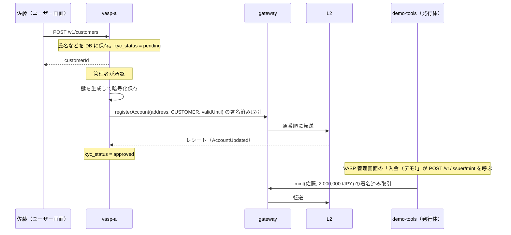
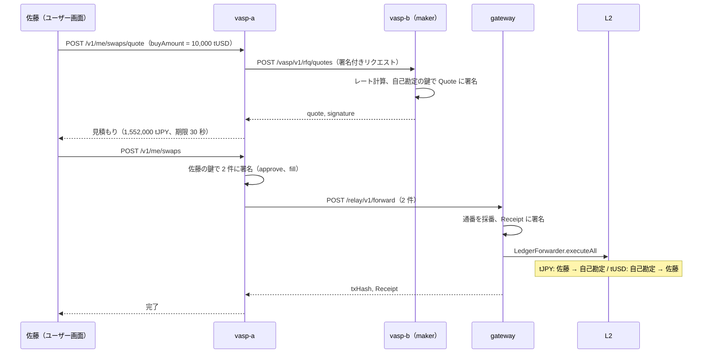
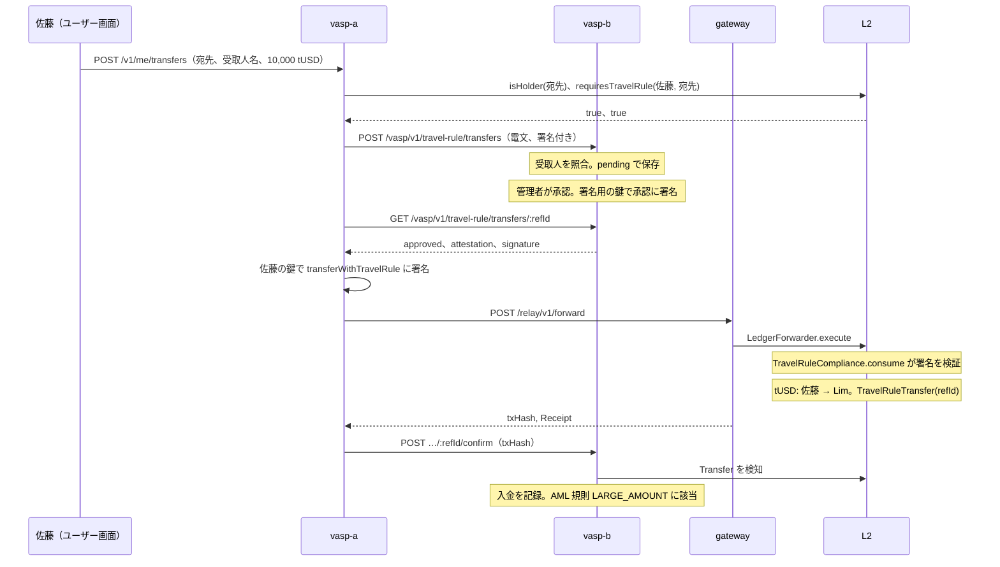
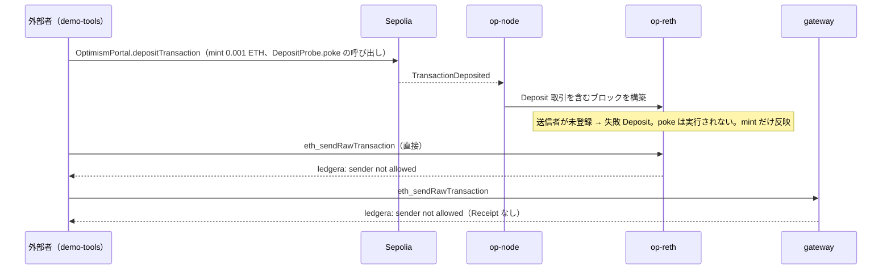
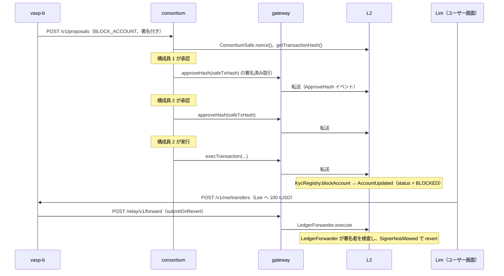
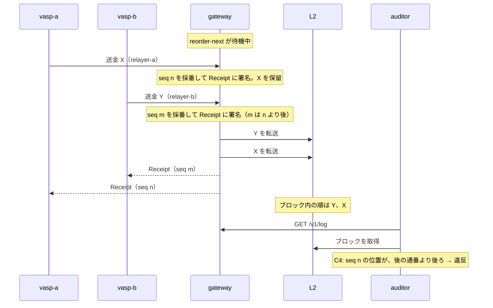
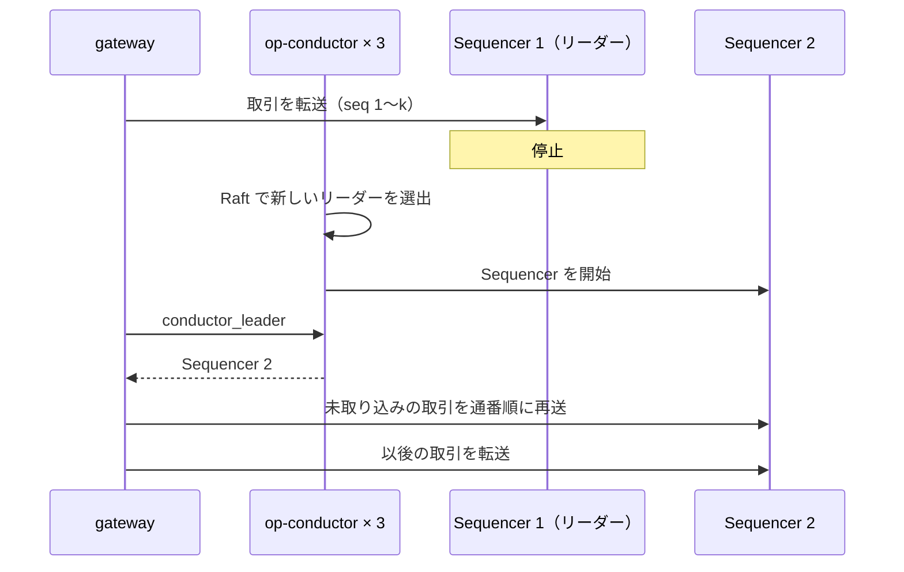

# 09 デモ場面のシーケンス

## 1. 設定

東京の佐藤さん（VASP A の顧客）が、シンガポールの仕入先 Lim さん（VASP B の顧客）に 10,000 USD を支払う。

| 登場人物 | 所属 | 準備 |
|---|---|---|
| 佐藤 太郎 | VASP A | 場面 1 で口座を開く |
| 鈴木 花子 | VASP A | 事前に登録する。残高なし |
| Lim Wei | VASP B | 事前に登録する。残高なし |
| Tan Mei | VASP B | 事前に登録する。1,000 tUSD を持つ |
| Lee Jun | VASP B | 事前に登録する。残高なし |
| VASP B の自己勘定 | VASP B | 初期化で tUSD と tJPY を持つ。交換の相手方 |
| 外部者 | なし | Sepolia に 0.05 ETH を持つ。Registry に登録しない |

- 事前の登録は `make demo-seed` が行う（[10-dev-ops.md](10-dev-ops.md)）。
- `make demo-seed` は実行のたびに新しいデモ回を作る。外部者以外の登場人物は、回ごとに新しいアドレスになる（9 節）。

場面の一覧。

| 場面 | 伝えること | 時間の目安 |
|---|---|---:|
| 1. 入る | KYC の結果だけがチェーンに載る | 1 分 |
| 2. 交換する | 2 通貨が 1 取引で入れ替わる。利用者はガス代を払わない | 1 分 |
| 3. 送る | VASP 間の確認を経て送金する。チェーンに氏名は載らない | 1 分 |
| 4. 破ろうとする | VASP を通さなくても、チェーンが拒否する | 3 分 |
| 5. 止める | 複数者の承認で遮断する。承認の記録がチェーンに残る | 2 分 |
| 6. 確かめる | 第三者が順序と履歴を検証できる | 3 分 |
| 7. 落とす（任意） | Sequencer が止まっても取引が続く | 2 分 |

進行上の注意。

- 場面 4 の L1 Deposit は L2 に入るまで 1〜2 分かかる。場面 3 を始める前に外部者画面で送っておく。
- 各場面の「確認点」は E2E テストの検証項目にする。

## 2. 場面 1: 入る

要件 7、8、15。

| 手順 | 画面 | 操作 | チェーン表示 |
|---:|---|---|---|
| 1 | ユーザー A | 佐藤さんが口座開設を申し込む | 変化なし |
| 2 | VASP A | KYC を承認する | 「登録の更新」の取引が出る。登録簿に 1 行増える |
| 3 | VASP A | 「入金（デモ）」で 2,000,000 tJPY を反映する | 「発行」の取引が出る |
| 4 | ユーザー A | ホームに残高が出る | - |

確認点。

- `KycRegistry.getAccount(佐藤)` が `vaspId = 1`、`kind = CUSTOMER`、`status = ACTIVE` を返す。
- `AccountUpdated` の引数に氏名もそのハッシュも含まれない。
- indexer の `GET /v1/registry/accounts/:address` に氏名の項目がない。
- 佐藤さんの tJPY 残高が 2,000,000。ETH 残高が 0。

## 3. 場面 2: 交換する

要件 3、22。

| 手順 | 画面 | 操作 | チェーン表示 |
|---:|---|---|---|
| 1 | ユーザー A | tJPY を売って 10,000 tUSD を買う見積もりを取る | 変化なし |
| 2 | ユーザー A | レート 155.20、残り 30 秒が出る。実行する | 「交換」の取引が 1 件出る。移転が 2 つ入っている |
| 3 | ユーザー A | 残高が 448,000 tJPY と 10,000 tUSD になる。手数料は 0 円 | - |
| 4 | ユーザー A | 1,000 tUSD の見積もりを取り、30 秒待ってから「期限切れの見積もりで実行」を押す | 失敗した取引が出る。理由は `QuoteExpired` |
| 5 | ユーザー A | 残高が変わっていない | - |

確認点。

- 成功した取引 1 件の中に、tJPY と tUSD の `Transfer` が 1 つずつある。
- 取引の送信者は relayer-a。佐藤さんの ETH 残高は 0 のまま。
- 期限切れの取引はレシートが失敗で、`failure.errorName` が `QuoteExpired`。前後で 4 つの残高（佐藤と自己勘定の 2 通貨）が変わらない。

## 4. 場面 3: 送る

要件 2、11、15。

| 手順 | 画面 | 操作 | チェーン表示 |
|---:|---|---|---|
| 1 | ユーザー A | Lim さんのアドレスと氏名を入れ、10,000 tUSD を送る | 変化なし。進行表示は「相手の事業者が確認中」 |
| 2 | VASP B | 受信した電文を開く。送付人と受取人の情報、氏名の照合結果が出る。承認する | 変化なし |
| 3 | ユーザー A | 進行表示が「送信済み（通番 n）」→「完了」になる | 「送金」の取引が出る。参照 ID が付いている |
| 4 | ユーザー B | Lim さんの残高が 10,000 tUSD になる | - |
| 5 | VASP B | アラート（高額の受領）が出る | - |

確認点。

- `TravelRuleAttestationConsumed` の `refId` が両 VASP の `travel_rule_messages.ref_id` と一致する。
- 取引の入力データ、イベント、indexer の応答のどこにも、電文の氏名が現れない。
- 承認の前に同じ移転を `transfer` で送ると、`TravelRuleRequired` で失敗する（場面 4 で見せる）。
- vasp-b の `alerts` に Lim さんの行があり、`status` が `open`。

## 5. 場面 4: 破ろうとする

要件 8、9、11。

| 手順 | 画面 | 操作 | 結果 | 止めた層 |
|---:|---|---|---|---|
| 1 | 外部者 | L1 から Deposit で `DepositProbe.poke()` を呼ぶ。場面 3 の前に送っておく | L2 のブロックに入るが失敗。カウンタは増えない。mint された 0.001 ETH だけが残る | 状態遷移 |
| 2 | 外部者 | L2 に直接トークン送金 | `ledgera: sender not allowed` | プール |
| 3 | 外部者 | L2 に直接 ETH 送金 | 同上 | プール |
| 4 | 外部者 | L2 に直接コントラクトをデプロイ | 同上 | プール |
| 5 | 外部者 | Gateway 経由で送金 | 同上。Receipt は出ない | 事前検査 |
| 6 | ユーザー A | 佐藤さんが「確認を飛ばして送る」で外部者のアドレスに 1,000 tJPY を送る | L2 上で失敗。理由は `AccountNotEligible` | 資産移転 |
| 7 | ユーザー A | 佐藤さんが「確認を飛ばして送る」で Lim さんに 1,000 tJPY を送る | L2 上で失敗。理由は `TravelRuleRequired` | 資産移転 |

手順 1 は L2 の結果が「失敗」になるまで待つ。その後、残高とカウンタを確認して手順 2 に進む。

説明の要点。

- 手順 1 は Sequencer を通らない経路。それでも同じ規則が適用される。
- 手順 1 の宛先 `DepositProbe` は、登録状態を見ないカウンタ。標準の実行層なら、同じ Deposit は成功してカウンタが増える。失敗の原因は実行層の規則だけ。標準の実行層で成功することは M2 で確認している（[02-chain.md](02-chain.md) の 10.2）。
- 手順 2〜4 は、トークン以外の取引も止まることを示す。トークンコントラクトだけの制限ではない。
- 手順 2〜4 は、op-reth の標準の検証（残高、手数料）を通る条件で送る。返るエラーは規則による拒否だけになる（[08-web.md](08-web.md) の 10.1）。
- 手順 6 と 7 は、登録済みの利用者でも、ルールに反する移転はチェーンが止めることを示す。

確認点。

- Deposit に対応する L2 取引のレシートが失敗。`DepositProbe.count(外部者)` が Deposit の前後で変わらない。
- 外部者の L2 の ETH 残高が Deposit の前より 0.001 ETH 増える。nonce が 1 増える。
- 対照として、登録済みの admin が同じ `to`、`data`、`gasLimit` で Deposit を送る。レシートが成功で、`DepositProbe.count(admin)` が 1 増える。
- 手順 2〜4 のエラー文が `ledgera: sender not allowed` を含む。残高不足や手数料のエラーではない。
- 手順 2〜5 の取引ハッシュがどのブロックにも入っていない。
- 手順 5 の拒否が Gateway の `GET /v1/rejections` に出る。
- 手順 6 と 7 の取引は L2 に入り、レシートが失敗。佐藤さんの残高は変わらない。
- 検証ノードを動かしている場合、手順 1 のブロックのハッシュが Sequencer と一致する。
- 対照ノードを動かしている場合、手順 1 と同じ Deposit のレシートが対照ノードでは成功で、`DepositProbe.count(外部者)` が 1 になる。確認できるのは、そのチェーンで最初の未登録 Deposit のときだけ。

## 6. 場面 5: 止める

要件 10、13、14。

| 手順 | 画面 | 操作 | チェーン表示 |
|---:|---|---|---|
| 1 | VASP B | Lim さんのアラートで「凍結を申請」を押す | 変化なし |
| 2 | コンソーシアム | 構成員 1 として申請を開き、承認する | 「承認」の取引が出る |
| 3 | コンソーシアム | 構成員 2 に切り替えて承認する | 「承認」の取引が出る。申請が実行可能になる |
| 4 | コンソーシアム | 実行する | 「実行」の取引が出る。登録簿の Lim さんの状態が「遮断」になる |
| 5 | ユーザー B | Lim さんが Lee さんに 100 tUSD を送る | 失敗した取引が出る。理由は `SignerNotAllowed` |

手順 5 の説明。代理送信では、取引の送信者は VASP B の代理送信用アカウントになる。実行層が見るのはこのアカウントで、Lim さんではない。遮断された Lim さんの署名は `LedgerForwarder` が止める。送金に限らず、`approve` などトークンを動かさない操作も止まる。

確認点。

- `ApproveHash` が 2 件、`ExecutionSuccess` が 1 件、同じ `safeTxHash` で出ている。
- `AccountUpdated` の `actor` が `ConsortiumSafe`、`status` が `BLOCKED`、`version` が 1 増えている。
- 承認が 1 件の時点では、consortium の `POST /v1/proposals/:id/execute` が 409 `NOT_EXECUTABLE` を返す。L2 に取引を送らない。
- 実行後、vasp-b の `alerts` の Lim さんの行が `frozen` になる。
- Lim さんの送金は L2 に入り、レシートが失敗。`failure.errorName` が `SignerNotAllowed`。Lim さんの残高は 10,000 tUSD のまま。
- 遮断後に Lim さんが交換（`approve` ＋ `fill`）を実行しても、`SignerNotAllowed` で失敗する。`allowance(Lim, AtomicSwap)` は 0 のまま。
- vasp-b の管理者が `reinstateAccount` を送っても `InvalidTransition` で失敗する。

## 7. 場面 6: 確かめる

要件 12、16、17、21、25。

### 7.1 到着順の監査

| 手順 | 画面 | 操作 | 結果 |
|---:|---|---|---|
| 1 | 監査者 | 到着順の監査を開く。集計区間は「この回」 | 違反 0 件。この回の全取引が通番順に並んでいる |
| 2 | デモ操作 | 「次の 2 件の順序を入れ替える」を押す | 仕掛けが待機中になる |
| 3 | ユーザー A | 佐藤さんが鈴木さんに 1,000 tJPY を送る | 通番 n が振られる。取引は保留され、画面は「送信中」のまま |
| 4 | ユーザー B | 60 秒以内に、Tan さんが Lee さんに 10 tUSD を送る | n より後の通番 m が振られる。m、n の順に転送され、両方とも完了する |
| 5 | 監査者 | 違反の一覧を見る | `ORDER_VIOLATION` が 1 件。通番 n の取引が、後から受け付けた取引より後ろに並んでいる。2 つの Receipt とブロック位置が証拠として出る |

監査者画面は 2 秒ごとに再取得する。2 件の取引が完了したら「再検査」を押し、違反を開く。

手順 3 と 4 の間に Gateway のコミット取引が入ることがある。その場合、m は n + 2 以降になる。違反は 1 件のまま。

確認点。

- 以下の確認は、現在のデモ回の開始通番と開始ブロックを `fromSeq`、`fromBlock` に指定して行う。
- 手順 1 の時点で `GET /v1/fifo/violations` が空。
- 手順 1 の時点で、この回の Receipt のうち未取り込みのものがない。場面 4 と 5 で失敗した取引も、ブロックに入っている。
- 手順 5 で違反が 1 件。`evidence` の 2 つの Receipt の署名が `ReceiptLog.verifyReceipt` で true。
- C1、C2、C3 は違反なし。Receipt とログ自体は正しいまま、順序だけが食い違う。

### 7.2 アドレスの追跡

| 手順 | 画面 | 操作 | 結果 |
|---:|---|---|---|
| 1 | 監査者 | Lim さんのアドレスを検索する | 所属は VASP B、状態は遮断。変更履歴に、登録と遮断の 2 件が出る |
| 2 | 監査者 | 移転履歴を見る | 佐藤さんのアドレスからの 10,000 tUSD の受領。参照 ID 付き |
| 3 | 監査者 | 受領の前のブロック番号を指定して残高を見る | 0 tUSD |
| 4 | 監査者 | 氏名の欄は「非開示」。開示を請求する | 状態が「請求中」になる |
| 5 | VASP B | 開示請求を承認する | - |
| 6 | 監査者 | 氏名が表示される | - |

VASP B が承認したら監査者画面へ戻る。開示の状態は 2 秒ごとに取得する。

確認点。

- 手順 3 の残高が同じブロック番号での `balanceOf` の `eth_call` と一致する。
- 手順 1 の履歴の各行に、ブロック番号、Registry のバージョン、操作者がある。
- 開示の前は、auditor と indexer のどの API も氏名を返さない。

## 8. 場面 7: 落とす（任意）

要件 19。冗長化構成（[02-chain.md](02-chain.md) の 11 節）で行う。

| 手順 | 場所 | 操作 | 結果 |
|---:|---|---|---|
| 1 | チェーン表示 | ネットワークのタブを開く | Sequencer 3 台とリーダーが出ている |
| 2 | 端末 | `make ha-kill-leader` | リーダーの op-node と op-reth が止まる |
| 3 | チェーン表示 | 待つ | 30 秒以内にリーダーが替わり、ブロック高が進み始める |
| 4 | ユーザー A | 佐藤さんが鈴木さんに 1,000 tJPY を送る | 完了する。通番は連続している |
| 5 | 監査者 | 到着順の監査を見る | 切替による違反が増えていない |
| 6 | 端末 | `make ha-restore` | 止めた組がフォロワーとして追いつく |

確認点。

- リーダーの切替が 30 秒以内。
- 切替の前後で、L2 のブロック番号に欠番と重複がない。
- 切替中に受け付けた取引が、切替後にブロックに入る。
- auditor の C4、C5 の違反が増えない。

## 9. デモの再演

チェーンを作り直さずに、場面 1 から再演できる。`make demo-seed` を実行して新しいデモ回を作る。

前の回から残るものと、その扱い。

| 残るもの | 再演への影響 | 扱い |
|---|---|---|
| 遮断された Lim さんのアドレス | 同じアドレスには送金できない。場面 3 が成立しない | 登場人物を回ごとに作り直す。新しい Lim さんは別のアドレスになる |
| 場面 6 で起こした順序違反 | 全期間の違反件数は 0 に戻らない。場面 6 の手順 1 が成立しない | 監査の集計を回の開始通番からにする。手順 1 は「この回の違反 0 件」を見せる |
| 登録簿の過去の行 | 前の回の顧客と、遮断済みの行が残る | 登録簿は既定で「この回」だけを表示する |
| 外部者の L2 残高と nonce | 回を重ねるごとに増える | 確認点は Deposit の前後の差で見る |
| 対照ノード | 最初の未登録 Deposit のブロックで導出が止まっている | 2 回目以降は使わない |
| VASP B の自己勘定の残高 | 場面 2 のたびに tUSD が 10,000 減る | 初期残高は 1,000,000 tUSD。100 回ぶんある |
| Safe の nonce、Registry のバージョン | 回を重ねるごとに進む | 確認点は前後の差で見る |

`make demo-seed` が行うこと（[08-web.md](08-web.md) の 10.1）。

1. 回の番号を 1 増やす。その時点の通番とブロックを、回の開始位置として記録する。
2. 鈴木さん、Lim さん、Tan さん、Lee さんを、回ごとのメールアドレスで登録する。佐藤さんは場面 1 で登録する。
3. 画面が新しい回に切り替わる。対象は、メールアドレス欄の初期値、登録簿の表示範囲、監査の集計区間。

再演の前に確かめること。

- 前の回の申請がコンソーシアムに未完了で残っていない。残っていれば実行するか、取り下げる。
- Gateway の仕掛けが「待機中」や「保留中」で残っていない。

初期状態（遮断も違反の記録もない状態）に戻すときは、環境を作り直す。L1 へのデプロイからやり直す（[02-chain.md](02-chain.md) の 13 節）。
