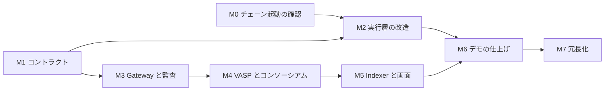

# 11 実装計画

## 1. 全体

2 本の流れで進め、M6 で合流する。

- チェーンの流れ: M0 → M2
- アプリの流れ: M1 → M3 → M4 → M5

| MS | 名前 | 規模 | 動作モード | 完了すると見せられる場面 |
|---|---|---|---|---|
| M0 | チェーン起動の確認 | 小 | devnet（無改造） | - |
| M1 | コントラクト | 中 | anvil | - |
| M2 | 実行層の改造 | 中 | devnet | 4 の手順 1〜4（コマンドで）。標準の実行層との比較を含む |
| M3 | Gateway と監査 | 中 | anvil | 6 の到着順（API で） |
| M4 | VASP とコンソーシアム | 大 | anvil | 1、2、3、5（API で流れだけ） |
| M5 | Indexer と画面 | 大 | anvil | 1、2、3、5（画面で。確認点も通る） |
| M6 | デモの仕上げ | 中 | devnet | 1〜6 |
| M7 | 冗長化 | 中 | devnet-ha | 7 |

共通の完了条件。

- その MS の受け入れ基準をすべて満たす。
- `make lint` と、その時点で存在するテストが通る。
- 設計と実装が食い違った箇所は、設計書を実装に合わせて直す。
- [12-open-issues.md](12-open-issues.md) の該当する要検証事項に結果を書く。

## 2. M0 チェーン起動の確認

目的: 公式イメージだけで Sepolia 上に L2 を立て、設計の前提を確かめる。

作業。

- [x] リポジトリの骨組み（`Makefile`、`.env.example`、`.gitignore`、`chain/versions.env`）
- [x] `chain/scripts/derive-accounts.ts` と `make keys`
- [x] `chain/scripts/deploy-l1.sh`、`gen-config.sh` と `make chain-deploy`。`SystemConfig.setGasConfigEcotone(0, 0)` を含む
- [x] `services/rpc-proxy`（単一の転送先。10 章 7 節）
- [x] `chain/compose/docker-compose.chain.yml` と `make chain-up`。op-reth は `OP_RETH_STOCK_IMAGE` を使う。ネットワークを `ledgera-chain` と `ledgera` に分ける
- [x] `make chain-shell`（`ledgera-chain` につないだ Foundry コンテナ）
- [x] `make status`（ブロック高、safe ブロック、残高）
- [ ] admin から `OptimismPortal.depositTransaction` を `cast send` で呼び、L2 に入ることを確認する
- [ ] ダミーの実装コントラクトで `ProxyAdmin.upgradeAndCall(0x42…0700, …)` を試す

受け入れ基準。L2 に取引を送る確認は `make chain-shell` の中で行う。

| 基準 | 確認方法 |
|---|---|
| L2 のブロックが 2 秒ごとに増える | `cast block-number` |
| Sepolia に Batch の取引が入り、safe ブロックが進む | Etherscan、`optimism_syncStatus` |
| admin の Deposit が L2 で成功し、mint 分の残高が増える | `cast balance` |
| `0x42…0700` にダミー実装を設定し、関数を呼べる | `cast call` |
| genesis に Safe v1.3.0 の実装がある | `cast code 0xfb1bffC9d739B8D520DaF37dF666da4C687191EA` |
| 開発用アカウント 0 が L2 に残高を持つ | `cast balance` |
| L1 の `SystemConfig` と L2 の `GasPriceOracle` の fee scalar が、どちらも 0 | `cast call` |
| L2 の取引のレシートの `l1Fee` が 0 | `cast receipt` |
| ホストから rpc-proxy 経由で L2 を読める。ホストからの `eth_sendRawTransaction` は `-32601` で拒否される | `cast block-number`、`cast publish` |
| デプロイと 1 時間の稼働で使った Sepolia ETH を記録した | 12 章 V5、V9 |

確かめる要検証事項: V5、V7、V9、V10、V12、V14、V16、V18、V19。

## 3. M1 コントラクト

目的: 03 章のコントラクトを実装し、anvil 上で初期化できるようにする。

作業。

- [x] `contracts/` の Foundry プロジェクト。依存は OpenZeppelin Contracts v5、safe-contracts v1.3.0、forge-std
- [x] `libraries/RegistryLayout.sol`（スロットとビット配置）
- [x] `KycRegistry.sol` とテスト（03 章 2.7）
- [x] `TravelRuleCompliance.sol` とテスト（4.4）
- [x] `LedgerToken.sol` とテスト（3.5）
- [x] `LedgerForwarder.sol` とテスト（5.4）
- [x] `AtomicSwap.sol` とテスト（6.5）
- [x] `ReceiptLog.sol` とテスト（7.4）
- [x] `DepositProbe.sol` とテスト（9.2）
- [x] `script/Bootstrap.s.sol`（`BOOTSTRAP_MODE=anvil` と `devnet`。やり直せる作り）
- [x] `chain/scripts/bootstrap-l2.sh`（anvil で動くところまで）
- [x] `packages/abis`（forge の出力から ABI を生成するスクリプト）
- [x] `packages/shared` の EIP-712 型定義、署名関数、テストベクタ（10 章 8.2）
- [x] `packages/config`（環境変数のスキーマ、チェーン定義、デプロイ結果の読み込み）

受け入れ基準。

| 基準 | 確認方法 |
|---|---|
| 03 章の各「テスト」節の項目がすべてテストになっていて通る | `make test-contracts` |
| Registry のスロットが 02 章 6.2 のテストベクタと一致する | 同上 |
| TypeScript で作った 4 種類の署名を Solidity が受け入れる | 同上 |
| 遮断された署名者の `approve` と `transfer` が、`LedgerForwarder` 経由で `SignerNotAllowed` になる。allowance と残高が変わらない | 同上 |
| anvil で初期化が最後まで通り、`deployments/anvil.json` ができる | `make anvil-up` |

確かめる要検証事項: V8。

## 4. M2 実行層の改造

目的: 要件 9 を実行層で強制し、DevNet で確かめる。

前半は M1 を待たずに始められる。後半は M1 の初期化スクリプトが要る。

作業（前半: fork リポジトリ）。

- [x] `ethereum-optimism/optimism` を `kuriyosh/optimism` に fork し、tag `op-reth/v2.9.0` からブランチ `ledgera/op-reth-v2.9.0` を切る
- [x] 02 章 6.3 と 6.4 の変更箇所がこの tag でも同じ位置にあることを確認する
- [x] `rust/op-revm/src/ledgera.rs`、`error.rs`、`handler.rs` の変更
- [x] `op-revm` の単体テスト（02 章 6.5）
- [x] `rust/op-reth/crates/node/src/ledgera.rs` と `node.rs` の変更
- [x] `op-reth` の結合テスト（02 章 6.5）
- [x] fork の CI（2 クレートの `cargo test`）

作業（後半: このリポジトリ）。

- [x] `chain/scripts/build-op-reth.sh` と `make chain-image`
- [x] `chain/versions.env` に `OPTIMISM_FORK_COMMIT` と `OP_RETH_IMAGE` を入れる
- [x] `chain/scripts/bootstrap-l2.sh` を devnet に対応させる（拒否の確認、`deployments/devnet.json` の書き出し）
- [x] 改造版のイメージで `make chain-up`、`make l2-bootstrap`（ローカル Sepolia フォーク）
- [x] `chain/compose/docker-compose.replica.yml`（検証ノード、対照ノード）、`chain/scripts/compare-heads.sh`、`compare-deposit.sh`
- [x] `make replica-up`、`replica-compare`、`control-up`、`control-compare`、`control-down`

受け入れ基準。L2 に取引を送る確認は `make chain-shell` の中で行う。

| 基準 | 確認方法 |
|---|---|
| 02 章 6.5 のテストが通る | fork で `cargo test` |
| 規則の有効化前は、未登録の送信者の取引が通る | 初期化が通ること |
| 有効化後、未登録の送信者の直接送信が `ledgera: sender not allowed` で拒否される | 開発用アカウント 1 で `cast send` |
| 有効化後、登録済みの送信者の取引が通る | admin で `cast send` |
| attacker（未登録）が `DepositProbe.poke()` を Deposit すると、改造版では失敗のレシートになる。`count(attacker)` は 0 のまま。mint は残る | attacker で `cast send`（L1）、`cast receipt` と `cast call`（L2） |
| 同じ Deposit が、標準の実行層では成功する。対照ノードでレシートが成功、`count(attacker)` が 1 | `make control-up`、`make control-compare` |
| 同じ `to`、`data`、`gasLimit` の Deposit を admin（登録済み）が送ると、改造版でも成功する。`count(admin)` が 1 増える | admin で `cast send`（L1）、`cast call`（L2） |
| 残高 0.001 ETH の attacker が、`maxFeePerGas` 3 gwei、`gas` 200,000 の取引を直接送ると、`ledgera: sender not allowed` で拒否される。残高不足のエラーにならない | Deposit の後に attacker で `cast send` |
| 同じ残高、`maxFeePerGas`、`gas` の登録済みの送信者の取引は受理され、ブロックに入る | vasp-a-admin が新しい EOA を `CUSTOMER` で登録する。admin が 0.001 ETH を送る。その EOA で `cast send` |
| `from` を省略した `eth_call` が通る | `cast call` |
| `from` に未登録アドレスを指定した `eth_estimateGas` がエラーになる | `cast estimate` |
| 状態を `SUSPENDED` にした送信者の取引が、次のブロックから拒否される | `cast send` |
| 検証ノードのブロックハッシュが Sequencer と一致する | `make replica-compare` |

- 対照ノードで確認できるのは、そのチェーンで最初の未登録 Deposit だけ（02 章 10.2）。`DepositProbe` への Deposit を、ほかの未登録 Deposit より先に行う。
- 上の表の 5〜7 行目で「失敗の原因が実行層の規則だけ」であることを確かめる。8、9 行目で「拒否の原因が残高や手数料ではない」ことを確かめる。

確かめる要検証事項: V1、V2、V3、V4、V7、V13、V15、V20、V21。

## 5. M3 Gateway と監査

目的: 到着順の受付と、その検証を動かす。

作業。

- [x] サービスの共通部品（起動、環境変数、ログ、エラー応答、DB 接続）
- [x] `services/gateway`: 形式検査、事前検査、直列区間、Receipt、ログ
- [x] `services/gateway`: JSON-RPC、Receipt・ログ・拒否履歴の API
- [x] `services/gateway`: コミットと稼働状況の API
- [x] `services/gateway`: 代理送信（検査、シミュレーション、取引の組み立て）
- [x] `services/gateway`: キューから通番順に転送
- [x] `services/gateway`: 取り込みの追跡、コミット
- [x] `services/gateway`: デモ用の仕掛け
- [x] `services/auditor`: 検査 C1〜C7、除外の確認、集計区間、再編成への対応、進行位置の保存、API、CLI
- [x] `docker-compose.yml`（postgres、gateway、auditor）と `docker-compose.anvil.yml`（anvil、rpc-proxy）

受け入れ基準。

| 基準 | 確認方法 |
|---|---|
| 04 章 13 節のテストが通る | `make test`、`make test-integration` |
| 07 章 3.8 のうち到着順に関するテストが通る | 同上 |
| 5 送信者から同時に 100 件送り、監査の違反が 0 件 | 結合テスト |
| 仕掛けを使うと `ORDER_VIOLATION` が 1 件出る | 結合テスト |
| 監査の対象が、発行済みの全 Receipt である。転送状態が `queued`、`forwarded`、`rejected` のどれでも、期限を過ぎて未取り込みなら `NOT_INCLUDED` になる | 単体テスト、結合テスト（転送先の遮断） |
| 除外として記録されるのは、監査ツールが L2 の状態で理由を確認できたエントリだけ。Gateway が申告した理由だけでは除外にならない | 単体テスト |
| Gateway を再起動しても、通番と連鎖が続く | 結合テスト |

確かめる要検証事項: V17。

## 6. M4 VASP とコンソーシアム

目的: 場面 1、2、3、5 の流れを API で最後まで通す。indexer を使う確認点は M5 で確かめる。

作業。

- [x] `packages/shared` の署名付きリクエスト
- [x] `services/vasp`: 顧客、KYC の承認、鍵の保管
- [x] `services/vasp`: メタトランザクションの作成、送金の状態管理、入金の検知
- [x] `services/vasp`: 再編成への対応（入金、送金、アラートの照合し直し）
- [x] `services/vasp`: トラベルルール（送付側、受取側）
- [x] `services/vasp`: 交換（taker、maker）
- [x] `services/vasp`: AML 規則、アラート、凍結申請、取り下げの依頼
- [x] `services/vasp`: 開示請求
- [x] `services/consortium`: 申請、承認、実行
- [x] `services/consortium`: 取り下げ（取消取引）、L2 との照合
- [x] `services/demo-tools`: 発行体の `POST /v1/issuer/mint`、デモ回の `POST /v1/demo/runs`
- [x] `make demo-seed`

受け入れ基準。

| 基準 | 確認方法 |
|---|---|
| 05 章 11 節と 06 章 8 節のテストが通る | `make test-integration` |
| 場面 1、2、3、5 の手順を API で順に呼び、送金、交換、申請がそれぞれ `confirmed`、`confirmed`、`executed` で終わる | 結合テスト |
| 凍結後の送金が `failed`、`error_code` が `SignerNotAllowed` で終わる | 結合テスト |
| 凍結後の交換（`approve` ＋ `fill`）が `SignerNotAllowed` で終わり、allowance が変わらない | 結合テスト |
| 確認を飛ばした送金（場面 4 の手順 6、7）が `AccountNotEligible`、`TravelRuleRequired` で終わる | 結合テスト |
| 承認済みの申請を取り下げると Safe の nonce が進み、元の操作を L2 で実行できない | 結合テスト |
| 入金のブロックが再編成で消えると、入金が `reorged`、アラートが `invalidated` になる | 結合テスト（anvil の `evm_revert`） |
| `make demo-seed` を 2 回実行すると、同じ氏名で別のアドレスの顧客ができる | 結合テスト |

## 7. M5 Indexer と画面

目的: 場面 1、2、3、5 を画面で見せる。

作業。

- [x] `services/indexer`: 取り込み、再編成、確定段階
- [x] `services/indexer`: 復号、残高、Registry の履歴
- [x] `services/indexer`: 失敗理由
- [x] `services/indexer`: API
- [x] `apps/web`: 枠組み（役割タブ、2 分割、Route Handler）
- [x] `apps/web`: チェーン表示（取引、登録簿、L1、ネットワーク）
- [x] `apps/web`: ユーザー画面
- [x] `apps/web`: VASP 管理画面
- [x] `apps/web`: コンソーシアム画面
- [x] `e2e/scenes/` の場面 1、2、3、5 と、場面 4 の手順 6、7

受け入れ基準。

| 基準 | 確認方法 |
|---|---|
| 07 章 2.7 のテストが通る | `make test-integration` |
| indexer のスキーマを消して取り込み直すと、API の応答が消す前と同じになる | `make test-integration` |
| 場面 1、2、3、5 の「確認点」がすべて通る（anvil） | `make e2e` |
| 場面 4 の手順 6、7 の「確認点」が通る（anvil） | `make e2e` |
| VASP の DB 以外に氏名が保存されていない | gateway、indexer、auditor、consortium、demo のスキーマを検索するテスト |
| 場面 1、2、3、5 を画面だけで通せる（anvil） | 09 章の手順を手で追う |
| 左の操作が 5 秒以内に右のチェーン表示に出る | 同上 |
| 登録簿のタブで、氏名の列を隠すとオンチェーンの情報だけになる | 同上 |
| 失敗した取引の理由がエラー名で出る | 場面 2 の手順 4 |

## 8. M6 デモの仕上げ

目的: DevNet 上で場面 1〜6 を通す。

作業。

- [x] `services/demo-tools`: 外部者の操作（手数料の設定と、送る前の残高の確認を含む）、仕掛けの中継
- [x] `services/auditor`: アドレス追跡、開示請求
- [x] `apps/web`: 外部者画面、監査者画面、デモ操作、デモ回による表示の切替（メールアドレス欄、登録簿、監査の集計区間）
- [x] `e2e/scenes/` の場面 4（手順 1〜5）と場面 6
- [ ] devnet を L1 へのデプロイから作り直す。M2 の確認で、Gateway を通さない取引が `auditStartBlock` より後に入っているため
- [ ] devnet での通し確認と、所要時間の計測
- [ ] デモの手順書（09 章に、押す順番と待ち時間を追記する）

受け入れ基準。

| 基準 | 確認方法 |
|---|---|
| 場面 1〜6 の「確認点」がすべて通る（devnet） | `make e2e` |
| 場面 1〜6 を画面だけで通せる（devnet） | 09 章の手順を手で追う |
| 通しの所要時間が 12 分以内 | 計測 |
| 通しの後、仕掛け以外の監査違反が 0 件 | `make audit` |
| デモを 2 回続けて通せる。2 回目は `make demo-seed` で新しい回を作り、チェーンは作り直さない | 09 章の手順を手で追う。`make e2e` を 2 回実行する |
| 2 回目の場面 6 の手順 1 で、この回の違反が 0 件と表示される | 同上 |
| 場面 4 の手順 2〜4 のエラーが、すべて `ledgera: sender not allowed` である | `make e2e` |
| vasp、consortium、indexer、auditor のコンテナとホストから、op-reth に取引を送れない | 各コンテナとホストから `eth_sendRawTransaction` を試す |
| 検証ノードのブロックハッシュが一致する | `make replica-compare` |

確かめる要検証事項: V6。

## 9. M7 冗長化

目的: 場面 7 を通す。

作業。

- [x] `chain/compose/docker-compose.ha.yml`。op-conductor の必須項目、Raft の待受と通知のアドレス、RPC のポートを 02 章 11.2 のとおりに設定する
- [x] op-conductor の初期化手順（`make ha-up` に含める）
- [x] rpc-proxy の転送先を 3 組にする
- [x] Gateway のリーダー追従と再送（04 章 7.3）
- [x] `make ha-kill-leader`、`make ha-restore`
- [x] チェーン表示のネットワークのタブに Sequencer の状態を出す
- [x] `e2e/scenes/scene7-failover.test.ts`
- [ ] 余力があれば、到着順の強化（02 章 7.3）

受け入れ基準。

| 基準 | 確認方法 |
|---|---|
| op-conductor が 3 台とも起動し、リーダーが 1 つ選ばれる | `conductor_leader` |
| 02 章 11.4 の障害試験 4 件が通る | 手動、E2E |
| 場面 7 の「確認点」が通る | `make e2e`（devnet-ha） |
| 単一 Sequencer の構成（M6 までの構成）も引き続き動く | `make up`、`make e2e` |

確かめる要検証事項: V11。
